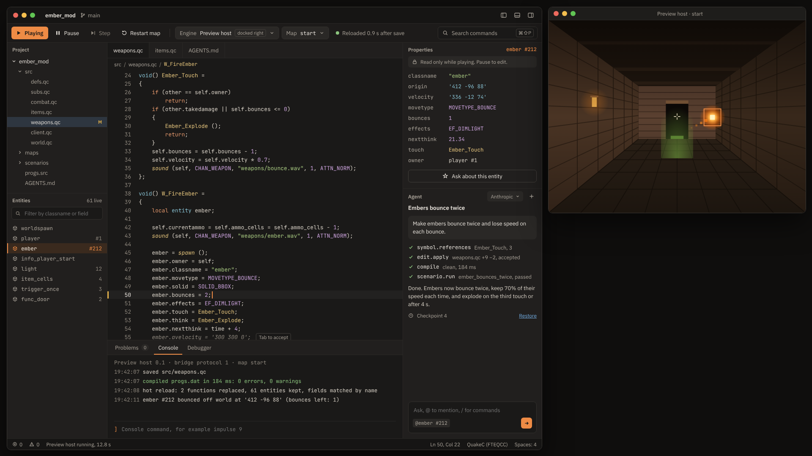

# QuakeC Studio

A native, cross-platform IDE for QuakeC, the scripting language of id Software's original *Quake*, written in Rust. It has Zed's editor feel and Roblox Studio's play loop: edit code, press Play, and see the change in the running game in about a second. It ships its own QuakeC compiler (no outside toolchain), a built-in agent that edits, compiles and tests through the same commands as the UI (also exposed over MCP), and a map editor with its own map compiler.



*Concept mockup of the approved design, not a screenshot.*

## Status

Released. The MVP, [`v2026.11.1`](https://github.com/quakecstudio/editor/releases/tag/v2026.11.1), shipped on 2026-11-20 when Phase 4's gate was signed off, and later versions are on the [releases page](https://github.com/quakecstudio/editor/releases), each with packages for macOS, Windows and Linux.

All eight phases (0 to 7) are built and their gates are closed, each with a report in [`docs/gates/`](docs/gates/). That covers the QuakeC VM and formats, the compiler (checked against FTEQCC and id's `qcc` on the rerelease and public mods), the language server, the `quakec-ide` command line, the code editor, the live preview, the built-in agent, release packages (the macOS package is signed and notarized, the Windows executables and the Linux rpm are signed), and a map editor. The map editor does entity and brush editing, textured and lit views, and has our own map compilers with coloured light, region compile and a background full compile, checked against id's tools and ericw-tools. What is left is the Post-MVP backlog; its largest piece is the Windows and Linux desktop checks ([#851](https://github.com/quakecstudio/editor/issues/851)). Work is tracked as GitHub issues generated from [`plan/`](plan/README.md), on the [project board](https://github.com/orgs/quakecstudio/projects/1).

<!-- next-goal:start (generated by plan/status.py --readme; do not edit by hand) -->
Every phase gate is closed. Post-MVP work is scheduled into a phase by an ADR before it starts.
<!-- next-goal:end -->

## Read first

| Document | What it covers |
| --- | --- |
| [User guide](https://www.quakecstudio.com/docs/) | The user guide, on the website: getting started, opening a mod, the play loop, debugging, the agent, MCP, the map editor, troubleshooting; its source is `public/docs/` in [quakecstudio/site](https://github.com/quakecstudio/site) |
| [`docs/roadmap.md`](docs/roadmap.md) | The overall plan: decisions so far, layers, the phases and their gates, where we are, how to work an issue |
| [`docs/design/design-doc.md`](docs/design/design-doc.md) | What we are building and why |
| [`docs/architecture.md`](docs/architecture.md) | A higher-level map of the subsystems: how the IDE and the engine fit together, the process model, and the edit-compile-preview play loop |
| [`docs/design/README.md`](docs/design/README.md) | The approved mockups and the design language |
| [`plan/README.md`](plan/README.md) | How the design becomes requirements, issues, phases and gates |
| [`docs/conventions.md`](docs/conventions.md) | Rust conventions (based on vouch) |
| [`docs/testing.md`](docs/testing.md) | The testing bar: the per-layer readiness reviews of Phases 1 and 2, and the gate review each later phase has |

## Building

With [rustup](https://rustup.rs/) installed (the toolchain is pinned in `rust-toolchain.toml`):

```bash
cargo build --locked
cargo test --locked
```

[`CONTRIBUTING.md`](CONTRIBUTING.md) lists every check a change must pass. Report security
problems as [`SECURITY.md`](SECURITY.md) describes.

## License

GPL-3.0-or-later ([LICENSE](LICENSE), [ADR-0002](docs/adr/0002-license-model.md)). Code ported from id Software's Quake source, which id released under GPL-2.0-or-later, keeps id's copyright notice. Quake's game data is not included and never will be; you need your own copy of Quake.

QuakeC Studio is an independent project and is not affiliated with or endorsed by id Software, ZeniMax Media or Bethesda.
