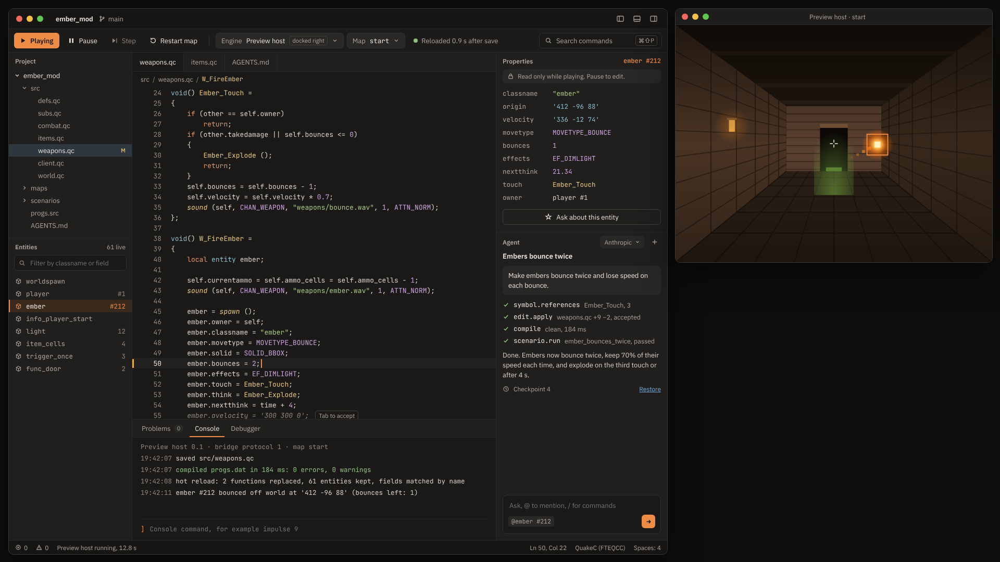

# QuakeC Studio

A native, cross-platform IDE for QuakeC, the scripting language of id Software's original *Quake*, written in Rust. It has Zed's editor feel and Roblox Studio's play loop: edit code, press Play, and see the change in the running game in about a second. It ships its own QuakeC compiler (no outside toolchain), a built-in agent that edits, compiles and tests through the same commands as the UI (also exposed over MCP), and a map editor with its own map compiler.



*Concept mockup of the approved design, not a screenshot.*

## Status

The Cargo workspace and its conventions are in place; the IDE itself is not built yet. Work is tracked as GitHub issues generated from [`plan/`](plan/README.md), on the [project board](https://github.com/orgs/quakecstudio/projects/1), and built by agents one phase at a time.

<!-- next-goal:start (generated by plan/status.py --readme; do not edit by hand) -->
**Now:** Phase 2: language core and editor (gate #80).

**Next run:** from a clone of this repo, with Claude Code in auto mode ([details](docs/agents/README.md)):

```
/goal Run /run-phase P2 agents until python3 plan/status.py --phase P2 --track agents prints a last line starting "STATUS P2 agents: COMPLETE" or "STATUS P2 agents: WAITING ON PEOPLE". Run that command at the end of every turn so its last line is in the transcript. Every merged PR passed CI. Stop after 150 turns.
```

The run stops when the phase is complete or only work for a person is left; start it again after acting on what it lists.
<!-- next-goal:end -->

## Read first

| Document | What it covers |
| --- | --- |
| [`docs/roadmap.md`](docs/roadmap.md) | The overall plan: decisions so far, layers, the phases and their gates, where we are, how to work an issue |
| [`docs/design/design-doc.md`](docs/design/design-doc.md) | What we are building and why |
| [`docs/design/README.md`](docs/design/README.md) | The approved mockups and the design language |
| [`plan/README.md`](plan/README.md) | How the design becomes requirements, issues, phases and gates |
| [`docs/conventions.md`](docs/conventions.md) | Rust conventions (based on vouch) |
| [`docs/testing.md`](docs/testing.md) | The test-suite readiness bar a layer must pass before work above it starts |

## Building

With [rustup](https://rustup.rs/) installed (the toolchain is pinned in `rust-toolchain.toml`):

```bash
cargo build --locked
cargo test --locked
```

[`CONTRIBUTING.md`](CONTRIBUTING.md) lists every check a change must pass. Report security
problems as [`SECURITY.md`](SECURITY.md) describes.

## License

GPL-3.0-or-later ([LICENSE](LICENSE), [ADR-0002](docs/adr/0002-license-model.md)). Code ported from id Software's Quake source, which id released under GPL-2.0-or-later, keeps id's copyright notice. Quake's game data is not included and never will be; you need your own copy of Quake.

QuakeC Studio is an independent project and is not affiliated with or endorsed by id Software, ZeniMax Media or Bethesda.
