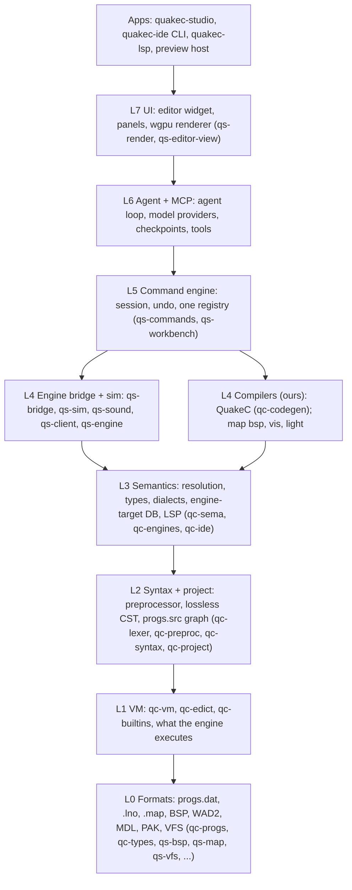

# Architecture

A higher-level map of QuakeC Studio for a new contributor: the big subsystems, how the IDE
and the engine fit together, where the process boundaries are, and how an edit becomes a change
you can see in the running game. It is the companion to [`layers.md`](layers.md), which is the
authoritative crate-by-crate layer model (ARCH-1, [design doc](design/design-doc.md#architecture)).
This page groups those layers into subsystems and explains the flow between them; `layers.md`
has the per-crate detail and the rule that `cargo xtask layers` enforces.

The source of truth for what we are building and why is the
[design document](design/design-doc.md). Where this page and the design document disagree, the
design document wins and this page is fixed, the same convention [`scope.md`](scope.md) uses.

## One product, two sides

QuakeC Studio is one Rust workspace that is really two subsystems joined at a play loop:

- **The IDE side** edits, understands and compiles QuakeC: the code editor, the semantic core,
  the compiler, the command engine and the agent harness.
- **The engine side** runs the result: the preview host, a Rust engine built from id's GPL
  source that executes the compiled progs, simulates the world, renders it and plays its sound.

The two meet at the engine bridge. The guiding principle is that the running game, not the
code, is the product (design doc, Product principles): edit, press Play, see it, click an
entity, inspect it, change it. Code, world and agent are one loop.

Everything a user, the CLI or the agent can do is a command in one registry (design doc,
Product principles): if the UI can do it, the agent and the CLI can too. That registry is what
ties the two sides together under a single surface.

## The layer stack

Crates sit in layers L0 to L7 plus `apps`, from id's file formats at the bottom to the UI and
the binaries at the top; a crate may depend only on its own layer or a lower one, so the
foundations never learn about the editor above them. [`layers.md`](layers.md) is the detailed
source for this and [`layers.toml`](../layers.toml) records every crate's layer. The condensed
picture:

*Arrows point down to what a layer uses. This is the design doc's diagram with crate names
folded in; see [`layers.md`](layers.md) for the full version, the separate C oracle processes
and the enforcement rule.*

## The IDE side

### Foundations and the VM (L0, L1)

The bottom of the stack models what id's engine actually executes, so every higher feature
agrees with the game (design doc, Foundation layers from first principles). L0 holds the file
formats as id defined them: progs.dat and the QC type layout (`qc-progs`, `qc-types`), the
`.lno` line maps (`qc-lno`), and the asset and container formats the engine reads (`qs-bsp`,
`qs-map`, `qs-mdl`, `qs-wad`, `qs-wav`, `qs-pak`, with `qs-vfs` building the search path over
them). L1 is the virtual machine: `qc-vm` runs the opcodes, `qc-edict` is the entity memory it
shares with the engine, and `qc-builtins` is the builtin table. Each is specified from id's
source and checked against an oracle in CI.

### Semantic core (L2, L3)

The language core is a rust-analyzer-style engine: a lossless syntax tree, incremental queries,
and one semantic model shared by the editor, the LSP and the agent (design doc, Language core).
L2 turns text into structure: the lexer and preprocessor (`qc-lexer`, `qc-preproc`), the
error-tolerant parser that produces a lossless CST (`qc-syntax`), and the `progs.src` project
graph (`qc-project`). L3 is meaning: name resolution, types, dialect profiles (vanilla, FTEQCC,
GMQCC as feature flags on one parser) and the engine-target database of per-engine builtins
(`qc-sema`, `qc-engines`), with the LSP outputs in `qc-ide`. The IDE uses the core in-process;
the `quakec-lsp` binary is the same crates behind a different front end, so other editors
benefit too. See [`design/semantic-model.md`](design/semantic-model.md) for the detail.

### Compiler (L4)

We write our own QuakeC compiler and run it in-process, so a fresh install builds a mod with
nothing else on the machine (design doc, Compiler). The semantic core feeds `qc-codegen`, which
emits progs.dat and the `.lno` line maps for the debugger, so the errors you see while typing
are exactly the errors the build reports. Correctness means a program compiled by us and run in
`qc-vm` leaves the same globals and edicts as id's VM running qcc's output; byte-identical
files are not a goal. id's original `qcc`, built from GPL source in the test harness, is the
vanilla oracle in CI only and is never shipped. [`design/back-end.md`](design/back-end.md)
covers code generation.

### Command engine and agent (L5, L6)

L5 is the one command registry: every menu item, keystroke and agent tool is a command with an
id, typed parameters and an undo step, with session and undo state (`qs-commands`,
`qs-workbench`, `qs-layout`, `qs-settings`). L6 is the agent harness, a client of that registry
rather than a special subsystem: it sees the project through the semantic core and acts through
the same commands as the user, in a loop of plan, edit, compile, test, preview, then propose
(design doc, Agent harness). Edits arrive as reviewable diffs, every run has a git-backed
checkpoint, and a run is done only when a compile is clean and its tests pass. The MCP server
exposes the same tools headless, and the Agent Client Protocol lets outside agents run in the
panel.

### Editor and UI (L7, apps)

L7 is the UI, kept a thin top layer on egui ([ADR-0003](adr/0003-ui-framework.md)): the editor
widget, panels and diff review (`qs-editor-view`) and the wgpu renderer shared with the engine
side (`qs-render`). The `apps` binaries assemble the stack: `quakec-studio` is the desktop app,
`quakec-ide` is the CLI and MCP entry point, `quakec-lsp` is the language server, and
`preview-host` is the engine (below). The layout puts the game in the middle: Play, Pause, Step
and Restart in the toolbar, project and live Entities outliner on the left, the code editor
beside the live game view in the centre, entity Properties and the agent panel on the right,
and Problems, Console and Debugger along the bottom.

## The engine side

Live preview always runs our own engine, the preview host, never an outside one
([ADR-0005](adr/0005-default-preview-target.md)), so it behaves the same on macOS, Windows and
Linux. The preview host is a Rust program built from id's GPL source
([ADR-0004](adr/0004-preview-host-base.md)). It runs the L1 VM (`qc-vm`, `qc-edict`,
`qc-builtins`), simulates the server world (`qs-sim`), reads the server's messages as a client
(`qs-client`), renders through wgpu with the same renderer as the IDE and the map editor
(`qs-render`) and plays sound (`qs-sound`). `qs-engine` holds the shared engine pieces. It is an
`apps` binary that runs as its own process beside the IDE; its simulation is compared frame by
frame with id's engine as a CI oracle, and its rendering and sound within stated tolerances.

The map editor and its map compiler (post-MVP, Phases 5 to 7) belong to this side too: maps and
code share one project, one semantic model and one play loop, so entity definitions are derived
from the semantic core rather than hand-maintained FGD files (design doc, Map editor). Its
renderer is the same `qs-render` built for the preview host.

## Process model

Most of QuakeC Studio runs in one process: the IDE loads the whole layer stack, including the
compiler and the semantic core, in-process. Two kinds of thing run as separate processes:

- **The preview host** runs as its own process beside the IDE. The IDE talks to it through a
  bridge client (`qs-bridge`) over a local socket (a Unix socket, or its platform equivalent),
  speaking a versioned JSON protocol specified in
  [`spec/bridge-protocol.md`](spec/bridge-protocol.md) (BRIDGE-1 to BRIDGE-7). The bridge
  carries commands such as `reload`, `inspect`, `set_breakpoint`, `step`, `console` and
  `screenshot` down to the host, and structured events such as `progs/loaded`, `edict/changed`
  and `qc/error` back up. Running the engine in its own process keeps a game crash from taking
  the IDE with it and lets the host own its own GPU and input.
- **The C oracles** (id's `qcc`, `qbsp`, id's VM and id's engine) are separate C programs built
  from GPL source and used only in CI, to prove our Rust reimplementations match id's behaviour.
  They are never shipped and are never needed to build or run the IDE. They are not crates and
  not part of the layer stack; see [`layers.md`](layers.md) and
  [`porting.md`](porting.md).

## The play loop: edit to live preview

The loop that joins the two sides, data and control flowing top to bottom and events back up:

1. **Edit.** You type in the editor (`qs-editor-view`). Each keystroke updates the semantic core
   incrementally, so navigation, diagnostics and completion stay live without a full reparse.
2. **Compile.** Saving runs a command on the registry (`qs-commands`) that feeds the semantic
   core's output to the compiler (`qc-codegen`). It produces a progs.dat and `.lno` line maps,
   reporting the same diagnostics you saw while typing.
3. **Reload.** The command engine sends `reload` to the preview host over the bridge
   (`qs-bridge`). The host loads the new progs over the running map and migrates globals and
   fields by name and type where they still match. When a reload would drop state (new fields,
   changed types, a removed function an entity points at), the UI says so first and offers a map
   restart instead (design doc, State honesty).
4. **See and inspect.** The host simulates (`qs-sim`) and renders (`qs-render`) the result and
   streams events back over the bridge: entities spawned and changed, console lines, QC errors
   and breakpoint hits. Clicking an entity in the game or the Entities outliner selects it
   everywhere, down to its spawn and think functions in the code. Pause freezes the world so
   you, or the agent, can inspect it.

The agent drives the same loop through the same commands: it edits, compiles with `compile`,
runs unit-level checks with `vm.run` in `qc-vm`, runs scripted scenarios against the headless
preview host, and inspects live state with `engine.inspect`, then proposes a reviewable diff.

## Where to go next

- [`layers.md`](layers.md) and [`layers.toml`](../layers.toml): the authoritative layer model
  and every crate's layer.
- [`design/design-doc.md`](design/design-doc.md): the source of truth for what we are building
  and why; see its Architecture, Language core, Compiler, Engine bridge and live preview, Agent
  harness, Editor and UI, and Map editor sections.
- [`design/README.md`](design/README.md): the approved mockups and the design language.
- [`design/semantic-model.md`](design/semantic-model.md) and
  [`design/back-end.md`](design/back-end.md): the semantic core and code generation in depth.
- [`scope.md`](scope.md): what v1 is and is not, and where the MVP line falls.
- [`spec/bridge-protocol.md`](spec/bridge-protocol.md): the IDE-to-preview-host protocol.
- [`porting.md`](porting.md): how id's C becomes Rust and how the oracles are built.
