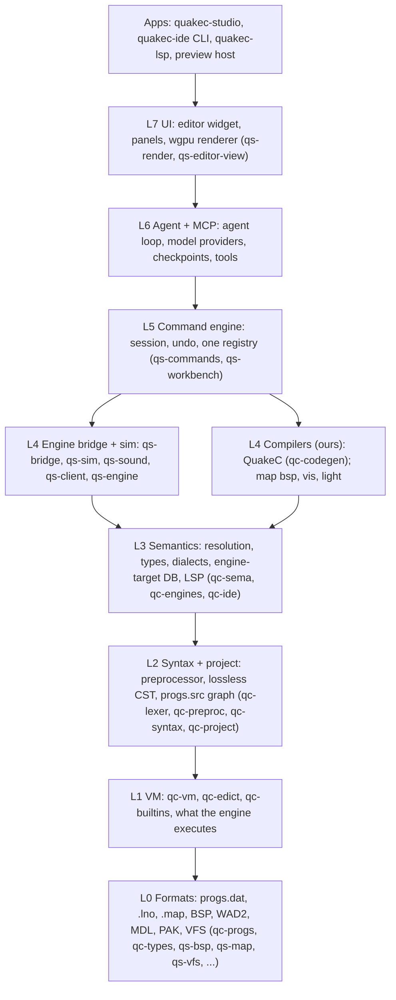
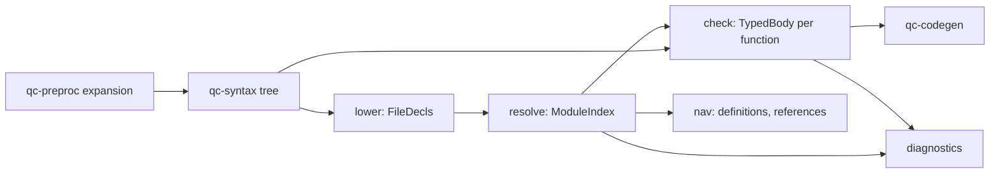

# Architecture

A higher-level map of QuakeC Studio for a new contributor: the big subsystems, how the IDE
and the engine fit together, where the process boundaries are, and how an edit becomes a change
you can see in the running game. It is the companion to [`layers.md`](layers.md), which is the
authoritative crate-by-crate layer model (ARCH-1, [design doc](design/design-doc.md#architecture)).
This page groups those layers into subsystems and explains the flow between them; `layers.md`
has the per-crate detail and the rule that `cargo xtask layers` enforces.

The source of truth for what we are building and why is the
[design document](design/design-doc.md). Where this page and the design document disagree, the
design document wins and this page is fixed, the same convention [`scope.md`](scope.md) uses.

## One product, two sides

QuakeC Studio is one Rust workspace (edition 2024) that is really two subsystems joined at a
play loop:

- **The IDE side** edits, understands and compiles QuakeC: the code editor, the semantic core,
  the compiler, the command engine and the agent harness.
- **The engine side** runs the result: the preview host, a Rust engine built from id's GPL
  source that executes the compiled progs, simulates the world, renders it and plays its sound.

The two meet at the engine bridge. The guiding principle is that the running game, not the
code, is the product (design doc, Product principles): edit, press Play, see it, click an
entity, inspect it, change it. Code, world and agent are one loop.

Everything a user, the CLI or the agent can do is a command in one registry (design doc,
Product principles): if the UI can do it, the agent and the CLI can too. That registry is what
ties the two sides together under a single surface. Three more principles shape the structure
below: the agent sees the live world and not just the files; the app never crashes a session
(clippy denies panics in shipped crates and every command runs behind a guard); and it is
honest about state, warning before a reload or an engine target would silently lose work.

## The layer stack

Crates sit in layers L0 to L7 plus `apps`, from id's file formats at the bottom to the UI and
the binaries at the top; a crate may depend only on its own layer or a lower one, so the
foundations never learn about the editor above them. [`layers.md`](layers.md) is the detailed
source for this and [`layers.toml`](../layers.toml) records every crate's layer. The condensed
picture:

*Arrows point down to what a layer uses. This is the design doc's diagram with crate names
folded in; see [`layers.md`](layers.md) for the full version, the separate C oracle processes
and the enforcement rule. Two crate families run through every layer: `qc-*` is the QuakeC
language, VM and compiler stack, and `qs-*` is the Quake engine, file formats and IDE
infrastructure.*

The rule is mechanical, not advisory: `cargo xtask layers` reads [`layers.toml`](../layers.toml)
and every member's `Cargo.toml` and fails the build when a crate depends on a higher layer,
naming both crates and their layers (`qs-vm (L1) depends on qs-sema (L3)`). Normal, dev and
build dependencies all count, so a test cannot reach up a layer either; cross-layer integration
tests live in `qs-tests`, which, with `qs-bench` and `qs-differential`, sits outside the ranking
in the `tests` group and may depend on anything. A crate in a layer may depend on a sibling in
the same layer (L1's `qc-builtins` calls into `qc-vm`), so "lower only" is read as "no higher".

## The IDE side

### Foundations and the VM (L0, L1)

The bottom of the stack models what id's engine actually executes, so every higher feature
agrees with the game (design doc, Foundation layers from first principles). Each item is
specified from id's source in [`spec/`](spec/README.md), implemented in Rust, then checked
against an oracle in CI.

L0 holds the file formats as id defined them. `qc-progs` models the progs.dat v6 header,
statements, globaldefs, fielddefs, functions and the string table (from id's `pr_comp.h`),
with the FTE v7 extensions behind a flag; `qc-types` models the eight QC types (void, string,
float, vector, entity, field, function, pointer) and their global-slot layout. `qc-lno` holds
the `.lno` statement-to-source line maps the debugger reads (see [`spec/lno.md`](spec/lno.md)).
Alongside sit the asset and container formats the engine reads (`qs-bsp`, `qs-map`, `qs-mdl`,
`qs-wad`, `qs-wav`, `qs-pak`), with `qs-vfs` building the search path over them.

L1 is the virtual machine. `qc-vm` runs the opcodes, call stack, local stack, parameter and
return slots and builtin dispatch (from `pr_exec.c`, [`spec/vm.md`](spec/vm.md)); `qc-edict` is
the entity memory, field access and system globals it shares with the engine (from `pr_edict.c`
and `progdefs.h`, [`spec/edicts.md`](spec/edicts.md)); `qc-builtins` is the vanilla builtin
table with signatures and side effects, mockable for tests (from `pr_cmds.c`). Every fixed
limit lives in [`spec/limits.md`](spec/limits.md) as a named constant with the file and
identifier it comes from, never a magic number: a call depth of 32 frames (`LIMIT_MAX_STACK_DEPTH`,
so 31 QC functions active at once), a 2048-slot local stack (`LIMIT_LOCALSTACK_SIZE`), the
100000-statement runaway guard (`LIMIT_RUNAWAY`), 79 builtins (`LIMIT_NUM_BUILTINS`), 600 edicts
(`LIMIT_MAX_EDICTS`) and the 256-entry sound and model precache lists.

#### How we know it matches id

The foundation's correctness rests on differential oracles run in CI only, never shipped
([`spec/differential.md`](spec/differential.md), DIFF-1 to DIFF-11):

- **The differential runner** executes one scenario twice, once in a C oracle built unchanged
  from id's `pr_exec.c` and once in our `qc-vm`, and compares the two traces statement by
  statement, globals and edicts included. Neither program links or calls the other: the spec
  pages are the whole contract between them. Both sides implement the same deterministic mock
  engine (the world and edicts at map start, the clients, the server frames that call QuakeC,
  and all 79 builtins), so a run's trace depends only on the scenario's files, never a clock or
  the environment.
- **A scenario** ([`spec/scenario.md`](spec/scenario.md), [`spec/differential.md`](spec/differential.md)
  DIFF-2) is a small text file naming a progs, a map's entities and the settings of one run,
  down to the random seed and per-frame client inputs, so a divergence reproduces exactly.
- **The corpus** ([`../corpus/manifest.toml`](../corpus/manifest.toml)) is id 1.01 QuakeC, the
  2021 rerelease QuakeC and a set of public mods and maps, each fetched by checksum and never
  kept in the repo, each compiled with id's qcc and with our compiler.
- **Fuzzing** feeds random but well-formed progs to both VMs and flags any divergence, and must
  never crash the parser.

Where id's C is undefined or platform-dependent, the spec fixes a single answer that both mocks
implement, so the two traces still agree; the VM's own undefined cases stay id's and are
recorded as expected divergences.

### Semantic core (L2, L3)

The language core is a rust-analyzer-style engine: a lossless syntax tree, incremental queries,
and one semantic model shared by the editor, the LSP and the agent (design doc, Language core;
[`design/semantic-model.md`](design/semantic-model.md)). The design has one governing rule: the
semantic model does all the checking, and the code generator only emits. Every error and warning
id's `qcc` and FTEQCC can raise is raised here, where the editor and the language server see it
without a build, so the errors you see while typing are exactly the errors the build reports.

L2 turns text into structure: the lexer and preprocessor (`qc-lexer`, `qc-preproc`) handle
`#include`, `#define`, `#ifdef` and FTEQCC pragmas with macro expansion tracked back to source
spans; the hand-written, error-tolerant parser produces a lossless CST (rowan-style) so
formatting, comments and broken code survive every edit (`qc-syntax`); and `qc-project` models
the `progs.src` project graph, its include order and the several modules (SSQC, CSQC, MenuQC) of
one workspace, each with its own symbol table.

L3 is meaning, implemented across `qc-sema` as a pipeline of named stages, with `qc-engines` for
targets and `qc-ide` for the LSP outputs:

- **Lower** turns one file's syntax tree into plain data: its declarations, type declarations
  and each function's raw body.
- **Resolve** builds the `ModuleIndex` across every file in compilation order: one definition
  list, every name use bound to its definition, and the facts of each definition. Name
  resolution follows FTEQCC's one-pass order, so a name resolves to what is declared before it.
- **Check** produces a `TypedBody` per function: the type of every expression, the conversion
  applied, and the diagnostics of operators, calls, assignments and control flow.
- **The query database** memoizes each stage per file (salsa-style), so a keystroke re-lowers
  one file and re-resolves only what changed, which is what keeps navigation, diagnostics and
  completion live without a full reparse.

Outputs are an LSP server (go-to-definition, references, rename, hover docs, completion,
semantic tokens, inlay hints) and a tree-sitter grammar for highlighting elsewhere. The IDE uses
the core in-process; the `quakec-lsp` binary is the same crates behind a different front end, so
VS Code, Zed and Neovim users benefit too.

#### Dialects: one implementation, named rules

There is one parser and one semantic model with a profile, not a vanilla path and an FTEQCC
path (design doc, Language core; [`design/semantic-model.md`](design/semantic-model.md),
"Dialects"). Vanilla, FTEQCC and GMQCC are profiles, not separate grammars. Where the dialects
differ the code asks the profile a named question (`profile.locals_shadow_globals()`,
`profile.redeclaration_compares_defaults()`), each method citing both what `qcc` does and what
FTEQCC does instead; a bare `if fteqcc` in a stage is a defect. Settings that change mid-file
(`#pragma flag`, `#pragma warning`, `#pragma target`) are not on the profile; every stage reads
the settings in force at the offset it is looking at, from the preprocessor's per-offset tables.
The dialect's exact rules live in [`spec/dialect-fteqcc.md`](spec/dialect-fteqcc.md) and
[`spec/dialect-fteqcc-rerelease.md`](spec/dialect-fteqcc-rerelease.md).

#### The engine-target database

`qc-engines` holds, per engine a project can target, which builtins and extensions it supports,
so calling an `FTE_` builtin while targeting Ironwail is a diagnostic
([`spec/engine-targets.md`](spec/engine-targets.md), ENGT-1). The tables are generated by
`cargo xtask engines` from ten pinned fact sources (`fteextensions.qc`, `dpextensions.qc`, the
DarkPlaces client and menu defs, the rerelease defs, and the builtin tables of QuakeSpasm,
Ironwail and vkQuake), each pinned by commit and SHA-256. These are fact sources, not porting
upstreams: only names, numbers and signatures are taken from them, never comment text or code.
This database also travels into the agent's context so the model cites real builtins instead of
inventing them.

### Compiler (L4)

We write our own QuakeC compiler and run it in-process, so a fresh install builds a mod with
nothing else on the machine (design doc, Compiler; [`design/back-end.md`](design/back-end.md)).
The compiler keeps the one rule inverted from the semantic core's: the semantic model decides
what a program means, and the back end decides only where values live and which statements carry
them. The checker lowers each body into an intermediate layer (`qc_sema::ir`), a list of
statements whose operands are values rather than global offsets, with each temporary's life
explicit and each statement keeping its source origin for the `.lno`. An opcode the target lacks
is emulated there, once, where the warnings that depend on emitted code are raised.

`qc-codegen` then writes the progs from that layer through passes chosen by the dialect's
profile: allocation (vanilla takes a new slot per temporary; FTEQCC reuses a slot once its value
is dead) and layout (vanilla interleaves locals among the globals; FTEQCC lays a per-function
block after every global). It emits progs.dat v6, FTE's extended format when a project targets
it, and the `.lno` line maps for the debugger. Correctness means a program compiled by us and
run in `qc-vm` leaves the same globals and edicts as id's VM running qcc's output; byte-identical
files are not a goal, and compatibility is defined in tiers ([ADR-0020](adr/0020-compiler-compatibility-tiers.md)),
where even the oracles' quirks that real mods depend on are matched, and an oracle miscompile
counts as a defect only when the test harness proves it. The reuse of temporary slots is not
cosmetic: with a new slot per temporary Arcane Dimensions needs 94,535 globals, while FTEQCC's
output is 22,799 and fits the version 6 operand range. The target is an incremental recompile of
id1-sized code in under 200 ms (a target, to be measured). id's original `qcc`, built from GPL
source in the test harness, is the vanilla oracle in CI only and is never shipped.

### Command engine and agent (L5, L6)

L5 is the one command registry: every menu item, keystroke and agent tool is a command with an
id, typed parameters and an undo step, with session and undo state (`qs-commands`, plus
`qs-workbench`, `qs-layout`, `qs-settings`). A command runs behind a guard, so a bug fails one
action rather than the session (design doc, Never crash).

L6 is the agent harness, a client of that registry rather than a special subsystem: it sees the
project through the semantic core and acts through the same commands as the user, in a loop of
plan, edit, compile, test, preview, then propose (design doc, Agent harness). Its tools return
semantic answers and live state, not grep over files:

| Tool | What it returns |
| --- | --- |
| `project.symbols`, `symbol.definition`, `symbol.references` | Semantic answers from the model, not text search |
| `engine.builtins` | What the selected target engine supports, with signatures |
| `edit.apply` | A staged diff; nothing touches disk until accepted |
| `compile` | Diagnostics and a progs.dat from our compiler |
| `vm.run` | Runs a QC function in `qc-vm` with mocked builtins: unit tests in milliseconds |
| `scenario.run` | A headless engine run of a map plus scripted inputs, with assertions on edicts and globals |
| `engine.inspect`, `engine.console`, `engine.screenshot` | Live state from the running preview host |

Edits arrive as reviewable hunks you accept or reject one by one, every run has a git-backed
checkpoint you can roll back, and a run is marked done only when `compile` is clean and its tests
pass. The MCP server (`quakec-ide mcp`) exposes the same tools headless, `--connect` attaches to
a running app, and the Agent Client Protocol lets outside agents such as Claude Code run in the
panel. A per-project `AGENTS.md` holds the mod's rules and is loaded into every run. Model
providers are the user's choice (Anthropic, OpenAI-compatible endpoints, local models via
Ollama), with keys in the OS keychain and no telemetry.

### Editor and UI (L7, apps)

L7 is the UI, kept a thin top layer on egui ([ADR-0003](adr/0003-ui-framework.md)): the editor
widget, panels and diff review (`qs-editor-view`) and the wgpu renderer shared with the engine
side (`qs-render`). The editor widget, its text shaping with font fallback, IME and
screen-reader text are our own work on egui, since egui's built-in text edit is basic. The
framework was chosen after a spike against a 50,000-line project: type with semantic
highlighting, multi-cursor and IME, scroll at 120 Hz and render an inline diff, within the frame
budget on all three OSes.

The `apps` binaries assemble the stack: `quakec-studio` is the desktop app, `quakec-ide` is the
CLI and MCP entry point, `quakec-lsp` is the language server, and `quakec-engine` is the engine
(below). The layout puts the game in the middle: Play, Pause, Step and Restart in the toolbar,
project files and a live Entities outliner (edicts grouped by classname, updated by the host) on
the left, the code editor beside the live game view in the centre, entity Properties and the
agent panel on the right, and Problems, Console and Debugger (call stack, watches, breakpoints)
along the bottom.

## The engine side

Live preview always runs our own engine, the preview host, never an outside one
([ADR-0005](adr/0005-default-preview-target.md)), so it behaves the same on macOS, Windows and
Linux. The preview host is a Rust program built from id's GPL source
([ADR-0004](adr/0004-preview-host-base.md)). It runs the L1 VM (`qc-vm`, `qc-edict`,
`qc-builtins`), simulates the server world (`qs-sim`), reads the server's messages as a client
(`qs-client`), renders through wgpu with the same renderer as the IDE and the map editor
(`qs-render`) and plays sound (`qs-sound`). `qs-engine` holds the shared engine pieces and the
bridge client. It is an `apps` binary that runs as its own process beside the IDE.

The engine's behaviour is pinned by its own specs under [`spec/engine/`](spec/engine/world.md),
one per subsystem: [`physics.md`](spec/engine/physics.md) and [`move.md`](spec/engine/move.md)
for simulation, [`world.md`](spec/engine/world.md) for linking and collision,
[`client.md`](spec/engine/client.md), [`input.md`](spec/engine/input.md),
[`view.md`](spec/engine/view.md), [`sound.md`](spec/engine/sound.md),
[`console.md`](spec/engine/console.md), [`menu.md`](spec/engine/menu.md),
[`net.md`](spec/engine/net.md) and [`rerelease.md`](spec/engine/rerelease.md). Its server
simulation is compared frame by frame with id's engine (built from the pinned source as a CI
oracle), and its rendering and sound within stated tolerances; this is a separate suite from the
VM differential above, since `qs-sim` models movement and collision that the VM oracle's mock
engine deliberately leaves out.

The map editor and its map compiler (post-MVP, Phases 5 to 7) belong to this side too: maps and
code share one project, one semantic model and one play loop, so entity definitions are derived
from the semantic core rather than hand-maintained FGD files (design doc, Map editor). Its
renderer is the same `qs-render` built for the preview host, and its formats are specified in
[`spec/map.md`](spec/map.md) and [`spec/bsp.md`](spec/bsp.md).

## Process model

Most of QuakeC Studio runs in one process: the IDE loads the whole layer stack, including the
compiler and the semantic core, in-process. Two kinds of thing run as separate processes:

- **The preview host** runs as its own process beside the IDE. The IDE talks to it through a
  bridge client (`qs-bridge`, `qs-engine`) over a local socket (a Unix domain socket on macOS
  and Linux, a named pipe on Windows), speaking a versioned JSON protocol specified in
  [`spec/bridge-protocol.md`](spec/bridge-protocol.md) (BRIDGE-1 to BRIDGE-7). Running the engine
  in its own process keeps a game crash from taking the IDE with it and lets the host own its
  own GPU and input. See the bridge subsection below for the messages.
- **The C oracles** (id's `qcc`, `qbsp`, id's VM and id's engine) are separate C programs built
  from GPL source and used only in CI, to prove our Rust reimplementations match id's behaviour.
  They are never shipped and are never needed to build or run the IDE. They are not crates and
  not part of the layer stack; see [`layers.md`](layers.md) and [`porting.md`](porting.md).

### The bridge protocol

The bridge is this project's own design, shaped after the Debug Adapter Protocol (requests,
responses and events, capabilities announced at initialization) carried the way LSP carries
JSON-RPC 2.0 ([`spec/bridge-protocol.md`](spec/bridge-protocol.md)). Each message is a
`Content-Length` header and a JSON-RPC 2.0 content part (BRIDGE-1); the client's first request is
`initialize`, after which the host announces its version and a boolean capability per
flagged command, so a host built without reload or debugging says so and the client disables
those actions (BRIDGE-2).

Commands flow down and events flow up (BRIDGE-3, BRIDGE-4):

- **Commands** the client sends: `reload` (load a new progs over the running map, migrating
  state and listing what was cleared), `breakpoint/set` and `breakpoint/clear`, `step`
  (`statement`, `in`, `over`, `out` or `frame`), `inspect` (an edict's fields, the named
  globals, the call stack or the entity list), `evaluate` (the value of a QuakeC expression such
  as `self.owner.health`), `console`, `pause` and `resume`, `field/set`, `pick` (the edict under
  a window point), `entity/spawn`, `entity/remove`, `entity/edit`, `player/spawn_at`,
  `screenshot` and `window/place`.
- **Events** the host emits: `progs/loaded`, `map/loaded`, `edict/spawned`, `edict/changed`
  (once per edict per server frame), `edict/removed`, `qc/error`, `breakpoint/hit`,
  `console/line` and `state/changed` (paused or running, with the reason).

Some commands need a paused host (`step`, `inspect stack`, `evaluate`); some are refused while a
frame is stopped at a statement, because replaying the frame would drop their changes; and errors
use JSON-RPC's codes plus the host's own range (`-32002` not paused, `-32005` unsupported,
`-32008` stopped in frame). The schemas live in `spec/bridge-schema/`, one file per message, and
a test holds the schemas, their examples and the prose to each other.

## The play loop: edit to live preview

The loop that joins the two sides, data and control flowing top to bottom and events back up:

1. **Edit.** You type in the editor (`qs-editor-view`). Each keystroke updates the semantic core
   incrementally through its query database, so navigation, diagnostics and completion stay live
   without a full reparse.
2. **Compile.** Saving runs a command on the registry (`qs-commands`) that feeds the semantic
   core's checked model to the compiler (`qc-codegen`). It produces a progs.dat and `.lno` line
   maps, reporting the same diagnostics you saw while typing.
3. **Reload.** The command engine sends `reload` to the preview host over the bridge
   (`qs-bridge`). The host loads the new progs over the running map and migrates globals and
   fields by name and type where they still match. When a reload would drop state (new fields,
   changed types, a removed function an entity points at), the UI lists what will reset and
   offers a map restart instead, before you lose work (design doc, State honesty; BRIDGE-4.8
   reports `migrated`, `lost` and `added` with a reason for each).
4. **See and inspect.** The host simulates (`qs-sim`) and renders (`qs-render`) the result and
   streams events back over the bridge: entities spawned and changed, console lines, QC errors
   and breakpoint hits. Clicking an entity in the game or the Entities outliner selects it
   everywhere, down to its spawn and think functions in the code. Pause freezes the world so
   you, or the agent, can inspect it.

The agent drives the same loop through the same commands: it edits, compiles with `compile`,
runs unit-level checks with `vm.run` in `qc-vm`, runs scripted scenarios against the headless
preview host with `scenario.run`, and inspects live state with `engine.inspect`, then proposes a
reviewable diff.

## Quality gates

One command, `cargo xtask ci`, must pass before any merge (design doc, Quality, testing and
release): `fmt`, `clippy` with panics denied, all tests, the `layers` check, license and
asset-attribution checks, and the differential VM suite. Parser fuzzing must never crash the
parser and must round-trip losslessly; UI snapshot tests render the app offscreen through its own
harness; and headless quakec-engine integration tests run scripted scenarios in CI on all three
OSes using open test assets, since id's data cannot be redistributed. Agent evals score a fixed
set of modding tasks on compile success, test pass and reviewer acceptance.

## Where to go next

- [`layers.md`](layers.md) and [`layers.toml`](../layers.toml): the authoritative layer model
  and every crate's layer.
- [`design/design-doc.md`](design/design-doc.md): the source of truth for what we are building
  and why; see its Architecture, Language core, Compiler, Engine bridge and live preview, Agent
  harness, Editor and UI, and Map editor sections.
- [`design/README.md`](design/README.md): the approved mockups and the design language.
- [`design/semantic-model.md`](design/semantic-model.md) and
  [`design/back-end.md`](design/back-end.md): the semantic core and code generation in depth.
- [`scope.md`](scope.md): what v1 is and is not, and where the MVP line falls.
- [`spec/README.md`](spec/README.md): the full spec index, including
  [`spec/vm.md`](spec/vm.md), [`spec/edicts.md`](spec/edicts.md),
  [`spec/progs.md`](spec/progs.md), [`spec/limits.md`](spec/limits.md),
  [`spec/differential.md`](spec/differential.md), [`spec/scenario.md`](spec/scenario.md),
  [`spec/bridge-protocol.md`](spec/bridge-protocol.md),
  [`spec/engine-targets.md`](spec/engine-targets.md) and the per-subsystem engine specs under
  [`spec/engine/`](spec/engine/world.md).
- [`porting.md`](porting.md): how id's C becomes Rust and how the oracles are built.
