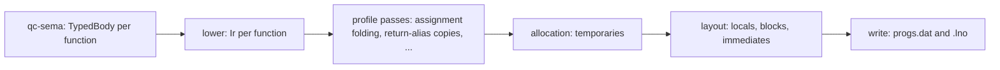

# The compiler's back end

How `crates/qc-codegen` should turn the semantic model's checked program into a `progs.dat`,
and how it gets there from what it does today. It carries
[ADR-0020](../adr/0020-compiler-compatibility-tiers.md) and issue
[#685](https://github.com/quakecstudio/editor/issues/685) (L-14, COMP-11). Read
[`semantic-model.md`](semantic-model.md) first: this document starts where it stops.

## The one rule

**The semantic model decides what a program means; the back end decides only where values
live and which statements carry them.** Names, types, conversions, constant values and every
diagnostic come from `qc-sema` (`semantic-model.md`, "The one rule"). The back end never works
any of them out again.

## Prior art

- **rust-analyzer**: `hir-def` lowers each body into an arena of expressions (`Body`), and
  `hir-ty` records each expression's type and its adjustments, the implicit conversions, in an
  `InferenceResult`. Consumers read both instead of re-reading the syntax.
- **rustc**: the typed tree is lowered to MIR, a control-flow graph of statements over locals
  and temporaries, and allocation and optimisations are passes over MIR.
- **GMQCC**, the other modern QuakeC compiler (graphitemaster/gmqcc@888ad563c7ff825ef049105adc9142e46a7cfb83):
  `parser.cpp` builds an AST (`ast.cpp`), which is lowered to an IR (`ir.h`: `ir_function`,
  `ir_block`, `ir_instr`, `ir_value`). Each `ir_value` keeps life ranges, commented "For the
  temp allocator", and `code.cpp` writes the progs from the IR.

We follow the same three steps: a typed body from the semantic model, an intermediate layer
lowered from it, and passes over that layer before the progs is written.

## Where it stands

| Crosses the boundary today | Worked out again in `qc-codegen` |
| --- | --- |
| `ModuleIndex`: the definition list, the facts of each definition, struct shapes, constant values | each name use, from its token (`Compiler::def_of`) |
| `TypedBody`: the type at an expression's span, read in one place (casts, `compile.rs`) | every other type (`Compiler::type_of`), the conversion of an operand (`floats_of`, `int_as_float`, `float_of_int`), constant folding (`folded`, `folded_with_one_constant`), the choice of opcode (`ops::select`) |

`semantic-model.md` describes `TypedBody` as an arena of expressions, each with its type, the
definition it names and the conversion applied, and says `qc-codegen` walks it. That
`TypedBody` was never built: the type is the only part recorded, keyed by span. The checker
(`qc-sema/src/check`, about 11,800 lines) does the rest of the work for its diagnostics and
throws it away; the code generator (`compile.rs` and `compile/arrays.rs`, about 5,300 lines)
walks each file's syntax tree and does it a second time, emitting statements and choosing
global offsets as it goes. FTEQCC's code-generation behaviour is spread through it as 52
dialect branches.

## The target



1. **`TypedBody`, finished as documented** (`qc-sema`, L3). Each expression in an arena, in
   source order, with its type, the definition a name resolves to, the conversion applied to
   it and its constant value when the profile folds it. The checker already computes all of
   them; it now keeps them.
2. **`Ir`** (`qc-codegen`, L4). Per function, a list of statements in emission order, each an
   opcode with operands that are values, not offsets: a definition, an immediate, a
   temporary `t0, t1, ...` the lowering made, or the return global. A temporary's life is
   explicit: the statement that writes it and the statements that read it. Jumps name
   statements. Each statement keeps its source origin, for the `.lno` (QC-27.19).
3. **Passes** over `Ir`, chosen by the dialect profile, each with its spec statements: the
   FTEQCC behaviours now inline in `compile.rs` (`opt_assignments`, FTE-18.12; the return
   global's copies, FTE-18.13; the `?:` result as a local), then optimisations (L-04).
4. **Allocation**: each temporary gets a slot. Vanilla `qcc` and today's FTEQCC profile take a
   new slot for every temporary (QC-21.5). An FTEQCC-exact mode, reusing slots as
   `QCC_GetTemp` does, can be added here later as one pass, if a mod is ever found to need it
   (ADR-0020).
5. **Layout and writing**: definitions, blocks (FTE-21.7), immediates and temporaries get
   their global offsets, then the progs and its `.lno` are written, as `write.rs` does today.

The statements' order stays `qcc`'s: the lowering visits each body in the order `qcc`'s and
FTEQCC's parsers emit, as `compile.rs` does now, so the vanilla output stays byte for byte
`qcc`'s where QC-27 says it is.

### An example

Generated program 555's `arr[(gf1 | K1) & 3] |= self.ff ? self.fv.x : (gf1 || gf1);` lowers
under FTEQCC to this `Ir` (an element is read and written through the array's `ArrayGet*` and `ArraySet*` functions, FTEF-19.78):

```
t0 = BITAND gf1, 3
t1 = LOAD_F self, ff
IFNOT t1, L1
t2 = LOAD_V self, fv        ; FTE-9.3: (e.v).x loads the whole vector
GOTO L2
L1: t2 = OR gf1, gf1
L2: STORE_F t0, parm0
CALL1 ArrayGet*arr
t3 = BITOR return, t2
STORE_F t0, parm0
STORE_F t3, parm1
CALL2 ArraySet*arr
```

`t2` is written as three words by `LOAD_V` and read as one. Allocation and layout decide what
those extra two words overwrite. Today's code generator gives `t2` a slot past the others, so
nothing is overwritten; FTEQCC gives it a one-word local below `t0`, so it overwrites the
index (ADR-0020, tier 3). In the `Ir` that is a property of two passes, not of the lowering.

## Getting there

Each step keeps every differential green, and the first two change no output. A golden check
compiles every corpus codebase and the generated programs of seed 1 with the code generator
before and after the step and requires the same bytes.

1. **`TypedBody` as documented.** The checker keeps each expression's resolved definition,
   conversion and constant value, and `qc-codegen` reads them: `def_of`, `type_of` and the
   conversion and folding helpers become lookups. The output is unchanged.
2. **`Ir` with a creation-order allocator.** The lowering emits `Ir` instead of statements
   and offsets; allocation gives every temporary a new slot in creation order and layout
   places blocks as FTE-21.7 says, so the progs is byte for byte the same.
3. **Profile passes.** The FTEQCC branches move out of the lowering into passes, one
   behaviour per change, each with its spec statements and a test of its own.
4. **What the passes make possible**: the oracle-defect proof of #649 can read the `Ir`; L-04's
   optimisations, a GMQCC profile (L-02) and the FTE extended format become passes and
   writers.

## Questions for Justin

- **Where `Ir` lives.** A module of `qc-codegen`, as proposed, or a crate of its own in L4 so
  another back end (a debugger's expression evaluator, say) can use it.
- **Step 1's scope.** `TypedBody` as documented covers casts, conversions and folding; whether
  it should also carry FTEQCC's opcode choice (`check/convert.rs`, `check/opcodes.rs`), so
  `ops::select` in `qc-codegen` goes too.
