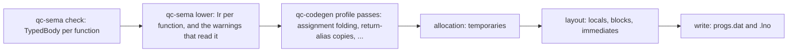

# The compiler's back end

How `crates/qc-codegen` should turn the semantic model's checked program into a `progs.dat`,
and how it gets there from what it does today. It carries
[ADR-0020](../adr/0020-compiler-compatibility-tiers.md) and issue
[#685](https://github.com/quakecstudio/editor/issues/685) (L-14, COMP-11). Read
[`semantic-model.md`](semantic-model.md) first: this document starts where it stops.

## The one rule

**The semantic model decides what a program means; the back end decides only where values
live and which statements carry them.** Names, types, conversions, constant values and every
diagnostic come from `qc-sema` (`semantic-model.md`, "The one rule"). The back end never works
any of them out again.

## Prior art

- **rust-analyzer**: `hir-def` lowers each body into an arena of expressions (`Body`), and
  `hir-ty` records each expression's type and its adjustments, the implicit conversions, in an
  `InferenceResult`. Consumers read both instead of re-reading the syntax.
- **rustc**: the typed tree is lowered to MIR, a control-flow graph of statements over locals
  and temporaries, and allocation and optimisations are passes over MIR.
- **GMQCC**, the other modern QuakeC compiler (graphitemaster/gmqcc@888ad563c7ff825ef049105adc9142e46a7cfb83):
  `parser.cpp` builds an AST (`ast.cpp`), which is lowered to an IR (`ir.h`: `ir_function`,
  `ir_block`, `ir_instr`, `ir_value`). Each `ir_value` keeps life ranges, commented "For the
  temp allocator", and `code.cpp` writes the progs from the IR.

We follow the same three steps: a typed body from the semantic model, an intermediate layer
lowered from it, and passes over that layer before the progs is written.

## Where it stands

The checker (`qc-sema/src/check`) now keeps, for each function body, the whole body as FTEQCC
generates it: `TypedBody::generated`, a list of `ir::BodyStatement`s in emission order, each an
opcode whose operands are `ir::Name`s: a definition's word, an immediate, a string literal, the
value a statement made (`Made`) or a word of it (`MadeWord`), the return global or a word of it,
a parameter slot, a jump's target statement, the `__va_list`, the `ret*` local, `prior`, an
array's getter or setter. Beside it:

| `TypedBody` holds | What it is for |
| --- | --- |
| `origin(i)` | the source statement each statement was generated in, for the `.lno` (QC-27.19) |
| `effects()` | what the body makes without a statement reading it, in order: each local it declares, a fold's immediate, and what a dropped branch or `NOT` named and the temporaries they took (FTE-3.6, FTEF-34.16) |
| `followed()` | whether the checker followed every statement; false at a construct it does not model yet: switches, labels, most intrinsics, struct copies, calls taking parameter defaults, emulations the code generator lowers itself |
| `BodyStatement::uses`, `temp_words` | which operands an opcode reads or writes, and the temporary each statement takes as it is generated (QC-21.5) |

In either dialect, `qc-codegen` writes a body from it (`compile/body.rs`) when the body was
followed, every operand its opcodes use is named and it calls no function with parameter
defaults: each effect made where the body makes it, each statement's temporary allocated in
creation order, each name resolved to its global. Any other body is still compiled by walking
the syntax tree (`compile.rs`). The vanilla checker generates a body as `qcc` emits it
(`check/vanilla.rs`); all of id 1.01's bodies but two are written from it, and the vanilla
output of the corpus and 2,000 generated programs is byte for byte the walk's. A probe over the corpora and the generated programs of
seed 1 measured the model against the walk: of 48,599 bodies, 47,883 are followed and identical,
statement by statement and operand by operand, and the writer declines the rest. The FTEQCC
differential over 200 generated programs agrees with the writer on.

What is still worked out a second time in `qc-codegen`:

| Crosses the boundary today | Worked out again in `qc-codegen` |
| --- | --- |
| `ModuleIndex`: definitions, their facts, struct shapes, constant values, each name use's definition; `TypedBody`: types at a span, binary operators' opcodes and fragments, the whole body | for walked bodies: every type (`Compiler::type_of`), conversions (`floats_of`, `int_as_float`, `float_of_int`), folding and the opcode choice (`ops::select`) |

## The target



1. **`TypedBody`, finished as documented** (`qc-sema`, L3). Each expression in an arena, in
   source order, with its type, the definition a name resolves to, the conversion applied to
   it and its constant value when the profile folds it. The checker already computes all of
   them; it now keeps them.
2. **`Ir`** (`qc_sema::ir`, L3). Per function, a list of statements in emission order, each an
   opcode with operands that are values, not offsets: a definition, an immediate, a
   temporary `t0, t1, ...` the lowering made, or the return global. A temporary's life is
   explicit: the statement that writes it and the statements that read it. Jumps name
   statements. Each statement keeps its source origin, for the `.lno` (QC-27.19). The
   lowering is where an opcode the target lacks becomes the statements that emulate it
   (`QCC_PR_StatementFlags`, FTEF-23.10), once, and where the warnings that depend on the
   emitted code are raised: the emulation warnings and the ones naming a temporary `temp_N`
   (FTEF-27.16). It is in L3, beside the checker, because those warnings are the semantic
   model's (`semantic-model.md`, "The one rule") and a lower layer cannot read a higher one;
   the checker's own model of emitted code (`check/emulate.rs`, its temporaries and its
   assignment folding) and the code generator's inline emulations are both replaced by it.
3. **Passes** over `Ir`, chosen by the dialect profile, each with its spec statements: the
   FTEQCC behaviours now inline in `compile.rs` (`opt_assignments`, FTE-18.12; the return
   global's copies, FTE-18.13; the `?:` result as a local), then optimisations (L-04).
4. **Allocation**: each temporary gets a slot. Vanilla `qcc` and today's FTEQCC profile take a
   new slot for every temporary (QC-21.5). An FTEQCC-exact mode, reusing slots as
   `QCC_GetTemp` does, can be added here later as one pass, if a mod is ever found to need it
   (ADR-0020).
5. **Layout and writing**: definitions, blocks (FTE-21.7), immediates and temporaries get
   their global offsets, then the progs and its `.lno` are written, as `write.rs` does today.

The statements' order stays `qcc`'s: the lowering visits each body in the order `qcc`'s and
FTEQCC's parsers emit, as `compile.rs` does now, so the vanilla output stays byte for byte
`qcc`'s where QC-27 says it is.

### An example

Generated program 555's `arr[(gf1 | K1) & 3] |= self.ff ? self.fv.x : (gf1 || gf1);` lowers
under FTEQCC to this `Ir` (an element is read and written through the array's `ArrayGet*` and `ArraySet*` functions, FTEF-19.78):

```
t0 = BITAND gf1, 3
t1 = LOAD_F self, ff
IFNOT t1, L1
t2 = LOAD_V self, fv        ; FTE-9.3: (e.v).x loads the whole vector
GOTO L2
L1: t2 = OR gf1, gf1
L2: STORE_F t0, parm0
CALL1 ArrayGet*arr
t3 = BITOR return, t2
STORE_F t0, parm0
STORE_F t3, parm1
CALL2 ArraySet*arr
```

`t2` is written as three words by `LOAD_V` and read as one. Allocation and layout decide what
those extra two words overwrite. Today's code generator gives `t2` a slot past the others, so
nothing is overwritten; FTEQCC gives it a one-word local below `t0`, so it overwrites the
index (ADR-0020, tier 3). In the `Ir` that is a property of two passes, not of the lowering.

## Getting there

Each step keeps every differential green, and the first two change no output. A golden check
compiles every corpus codebase and the generated programs of seed 1 with the code generator
before and after the step and requires the same bytes.

1. **`TypedBody` as documented.** The checker keeps each expression's type, conversion,
   constant value and the opcode `QCC_PR_ChooseOpcode` picks, and `qc-codegen` reads them:
   `type_of`, `ops::select` and the conversion and folding helpers become lookups. The output
   is unchanged. The types and the binary operators' opcodes were measured to agree already
   (#688).
2. **`Ir` with a creation-order allocator.** `qc_sema::ir` is the layer, and the lowering in
   `qc-sema` builds it from each checked body, emulations included; `qc-codegen` writes the
   progs from it instead of walking the syntax tree. Under way: the whole body
   (`TypedBody::generated`) and its writer cover the bodies the checker follows; what remains
   is the constructs it does not follow yet, after which the walk goes. Allocation gives every
   temporary a new slot in creation order and layout places blocks as FTE-21.7 says, so the
   progs is byte for byte the same. The checker's emulation warnings then read the lowering, and
   `check/emulate.rs`'s model of emitted code goes.
3. **Profile passes.** The FTEQCC branches move out of the lowering into passes, one
   behaviour per change, each with its spec statements and a test of its own.
4. **What the passes make possible**: the oracle-defect proof of #649 can read the `Ir`; L-04's
   optimisations, a GMQCC profile (L-02) and the FTE extended format become passes and
   writers.

## Decided

- **Where `Ir` lives** (Justin, 2026-11-03): in L3, as `qc_sema::ir`, with its lowering in
  `qc-sema`, because the semantic model's warnings depend on the emitted code. The code
  generator keeps the passes, allocation, layout and writing.
- **Step 1's scope**: it includes the opcode choice, since the types already agree and
  reading only them would remove almost nothing.
