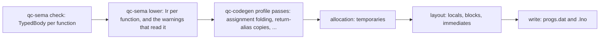

# The compiler's back end

How `crates/qc-codegen` turns the semantic model's checked program into a `progs.dat`, and
what is still to come. It carries
[ADR-0020](../adr/0020-compiler-compatibility-tiers.md) and issue
[#685](https://github.com/quakecstudio/editor/issues/685) (L-14, COMP-11). Read
[`semantic-model.md`](semantic-model.md) first: this document starts where it stops.

## The one rule

**The semantic model decides what a program means; the back end decides only where values
live and which statements carry them.** Names, types, conversions, constant values and every
diagnostic come from `qc-sema` (`semantic-model.md`, "The one rule"). The back end never works
any of them out again.

## Prior art

- **rust-analyzer**: `hir-def` lowers each body into an arena of expressions (`Body`), and
  `hir-ty` records each expression's type and its adjustments, the implicit conversions, in an
  `InferenceResult`. Consumers read both instead of re-reading the syntax.
- **rustc**: the typed tree is lowered to MIR, a control-flow graph of statements over locals
  and temporaries, and allocation and optimisations are passes over MIR.
- **GMQCC**, the other modern QuakeC compiler (graphitemaster/gmqcc@888ad563c7ff825ef049105adc9142e46a7cfb83):
  `parser.cpp` builds an AST (`ast.cpp`), which is lowered to an IR (`ir.h`: `ir_function`,
  `ir_block`, `ir_instr`, `ir_value`). Each `ir_value` keeps life ranges, commented "For the
  temp allocator", and `code.cpp` writes the progs from the IR.

We follow the same three steps: a typed body from the semantic model, an intermediate layer
lowered from it, and passes over that layer before the progs is written.

## Where it stands

The intermediate layer is `qc_sema::ir`, and the checker (`qc-sema/src/check`) lowers each
function body into it as it checks it: `TypedBody::generated`, the body's statements in emission
order, each an `ir::BodyStatement` whose operands are `ir::Name`s, values rather than offsets: a
definition's word, an immediate or a word of one, a string literal, the value a statement made
(`Made`) or a word of it (`MadeWord`), the return global or a word of it, a parameter slot or its
default, a jump's target statement, the `__va_list`, the `ret*` local, `prior`, an array's getter
or setter, a nested function's number. An opcode the target lacks is emulated there, once, where
the checker raises the warnings the emulation gives. Beside the statements:

| `TypedBody` holds | What it is for |
| --- | --- |
| `effects()` | what the body makes without a statement reading it, in order: each local it declares, a fold's immediate, a block of words taken before the statements that write it (a vector or a struct), what a dropped branch or `NOT` named (FTE-3.6, FTEF-34.16), a constant local's or an `autocvar`'s initial value, a nested function, and where each `for` loop begins and ends (FTEF-19.78) |
| `origin(i)` | the source statement each statement was generated in, for the `.lno` (QC-27.19) |
| `followed()` | whether the checker followed every statement; false only at the constructs no program of the corpora or the generated programs uses, such as a builtin local |
| `BodyStatement::uses`, `temp_words` | which operands an opcode reads or writes, and the temporary each statement takes as it is generated (QC-21.5) |

The vanilla checker generates a body as id's `qcc` emits it (`check/vanilla.rs`), the FTEQCC
checker as FTEQCC does. `qc-codegen` writes every body from the layer (`compile/body.rs`): each
effect made where the body makes it, each value given its slot by the allocation pass, each name
resolved to its global. There is no syntax walk; a body the checker did not follow is an internal
error. The code generator's own work is declarations and global initialisers (their values from
`ModuleIndex::initial_value`), the array functions FTEQCC synthesises, precaches, and writing the
progs and its `.lno`.

The passes are chosen by the dialect's profile (`back_end.rs`, `BackEnd::of`):

| Pass | Vanilla | FTEQCC | Where |
| --- | --- | --- | --- |
| Allocation | each value a new slot in creation order (QC-21.5) | a slot reused once its value is dead, from the module's shared temporaries; a value read after a call in the function's block (FTE-21.8) | `compile/allocate.rs`, `CreationOrder`, `Overlapping` |
| Layout | parameters, locals and temporaries among the globals as they are met (QC-21.4) | a block per function after every global (FTE-21.9) | `program.rs`, `open_block`, `resolve_blocks` |

Every body of the corpus codebases that compile and of 2,000 generated programs of seed 1 is
written from the layer. The vanilla output is byte for byte what it was when the syntax walk
wrote it. Under FTEQCC the output differs from the walk's in allocation, temporaries taken in
creation order, and where the walk was wrong: a constant vector's component is a constant that
FTEQCC folds (FTEF-31.9). The compiler differentials find no divergence from the oracles beyond
the defects ADR-0020 lets the harness prove.

## The target



1. **`TypedBody`, finished as documented** (`qc-sema`, L3). Each expression in an arena, in
   source order, with its type, the definition a name resolves to, the conversion applied to
   it and its constant value when the profile folds it. The checker already computes all of
   them; it now keeps them.
2. **`Ir`** (`qc_sema::ir`, L3). Per function, a list of statements in emission order, each an
   opcode with operands that are values, not offsets: a definition, an immediate, a
   temporary `t0, t1, ...` the lowering made, or the return global. A temporary's life is
   explicit: the statement that writes it and the statements that read it. Jumps name
   statements. Each statement keeps its source origin, for the `.lno` (QC-27.19). The
   lowering is where an opcode the target lacks becomes the statements that emulate it
   (`QCC_PR_StatementFlags`, FTEF-23.10), once, and where the warnings that depend on the
   emitted code are raised: the emulation warnings and the ones naming a temporary `temp_N`
   (FTEF-27.16). It is in L3, beside the checker, because those warnings are the semantic
   model's (`semantic-model.md`, "The one rule") and a lower layer cannot read a higher one;
   the checker's own model of emitted code (`check/emulate.rs`, its temporaries and its
   assignment folding) and the code generator's inline emulations are both replaced by it.
3. **Passes** over `Ir`, chosen by the dialect profile, each with its spec statements: the
   FTEQCC behaviours now inline in `compile.rs` (`opt_assignments`, FTE-18.12; the return
   global's copies, FTE-18.13; the `?:` result as a local), then optimisations (L-04).
4. **Allocation**: each temporary gets a slot. Vanilla `qcc` takes a new slot for every
   temporary (QC-21.5). The FTEQCC profile reuses them as `QCC_GetTemp` does under
   `opt_overlaptemps` (FTE-21.8): each value's range runs from the statement that makes it to
   the last that names it, extended to a loop's back jump while it is live at the loop's start;
   a value whose range holds a call takes a slot of the function's block, as
   `QCC_RemapLockedTemps` moves it, and any other the first of the module's shared temporaries
   of its size that is free, laid out after every block. A big mod needs it: Arcane Dimensions
   had 94,535 globals with a new slot per temporary, where FTEQCC's progs has 22,799 and fits
   version 6.
5. **Layout and writing**: definitions, blocks (FTE-21.9), immediates and temporaries get
   their global offsets, then the progs and its `.lno` are written, as `write.rs` does today.

The statements' order stays `qcc`'s: the lowering visits each body in the order `qcc`'s and
FTEQCC's parsers emit, as `compile.rs` does now, so the vanilla output stays byte for byte
`qcc`'s where QC-27 says it is.

### An example

Generated program 555's `arr[(gf1 | K1) & 3] |= self.ff ? self.fv.x : (gf1 || gf1);` lowers
under FTEQCC to this `Ir` (an element is read and written through the array's `ArrayGet*` and `ArraySet*` functions, FTEF-19.78):

```
t0 = BITAND gf1, 3
t1 = LOAD_F self, ff
IFNOT t1, L1
t2 = LOAD_V self, fv        ; FTE-9.3: (e.v).x loads the whole vector
GOTO L2
L1: t2 = OR gf1, gf1
L2: STORE_F t0, parm0
CALL1 ArrayGet*arr
t3 = BITOR return, t2
STORE_F t0, parm0
STORE_F t3, parm1
CALL2 ArraySet*arr
```

`t2` is written as three words by `LOAD_V` and read as one. Allocation and layout decide what
those extra two words overwrite. Today's code generator gives `t2` a slot past the others, so
nothing is overwritten; FTEQCC gives it a one-word local below `t0`, so it overwrites the
index (ADR-0020, tier 3). In the `Ir` that is a property of two passes, not of the lowering.

## Getting there

Each step kept every differential green. A golden check compiled every corpus codebase and the
generated programs of seed 1 before and after each one.

1. **`TypedBody` as documented.** The checker keeps each expression's type, conversion,
   constant value and the opcode `QCC_PR_ChooseOpcode` picks (#688). Done.
2. **`Ir` with a creation-order allocator.** The checker lowers each body into
   `TypedBody::generated`, emulations included, and `qc-codegen` writes the progs from it. The
   syntax walk, its operand types and conversions, its inline emulations and the per-operator
   fragments it read are removed; allocation and layout are passes the profile chooses. Done
   (#685).
3. **Profile passes.** The FTEQCC behaviours the lowering still makes as it generates, the
   folding of a store into the statement that made its value (`opt_assignments`, FTE-18.12) and
   the return global's copies (FTE-18.13), move into passes over the layer, one behaviour per
   change, each with its spec statements and a test of its own.
4. **What the passes make possible**: the oracle-defect proof of #649 can read the layer; L-04's
   optimisations, a GMQCC profile (L-02) and the FTE extended format become passes and writers.

## Decided

- **Where `Ir` lives** (Justin, 2026-11-03): in L3, as `qc_sema::ir`, with its lowering in
  `qc-sema`, because the semantic model's warnings depend on the emitted code. The code
  generator keeps the passes, allocation, layout and writing.
- **Step 1's scope**: it includes the opcode choice, since the types already agree and
  reading only them would remove almost nothing.
