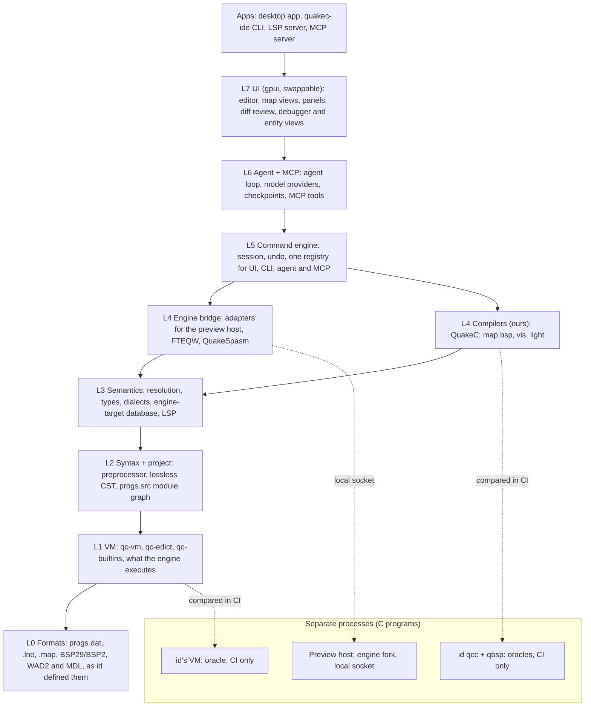

# QuakeC IDE - Design Document

Justin Plock · revision 36, 2026-10-15 (license decided; mod export, texture import, Mac game data)

> **Snapshot.** A copy of the design document as approved on 2026-10-15 (revision 34), updated in revision 35 for the license decision in ADR-0002 and in revision 36 for mod export, texture import and getting the game files onto a Mac. The plan in [`plan/`](../../plan/README.md) is derived from it and is what the build follows: every requirement here has an ID in [`plan/requirements.yaml`](../../plan/requirements.yaml) and is covered by at least one GitHub issue. Change the design with a PR to this file and the matching requirement, or record a decision in `docs/adr/`.

## Summary and goals

We are building a native, cross-platform QuakeC IDE in pure Rust with Zed's editor feel and Roblox Studio's play loop: an agent that edits, compiles, tests and previews mods in a running game. Its foundation layers are written from first principles against id Software's GPL Quake source, which serves as the ground-truth spec for the progs.dat format and VM semantics.

**Goals**

- A dialect-aware semantic engine (vanilla, FTEQCC, GMQCC; SSQC, CSQC, MenuQC) with fault-tolerant parsing, go-to-definition, references, rename and diagnostics, and our own compiler built on the same model, with no outside toolchain.
- Live preview: save, compile, and see the change in a running engine, with breakpoints and entity inspection.
- A built-in agent harness whose tools are the same commands the UI uses, also exposed over MCP and a CLI.
- A built-in map editor and map compiler that share the QuakeC project, its entity definitions and the play loop.
- Crafting Apps quality bar: one Rust codebase, signed native builds for macOS (universal), Windows and Linux, no crashes in shipped code.

**Non-goals for v1**

- Quake 2, Quake 3 and Half-Life map formats.
- GMQCC-only syntax (planned after the MVP).
- A web/WASM build (revisit after the editor widget decision in Editor and UI).
- Supporting Quake 2/3 game code.

## Background: the gaps we close

No QuakeC tool today combines dialect-aware semantics, cross-engine live preview and an agent loop. The earlier gap analysis found:

| Gap | Today | What we ship |
| --- | --- | --- |
| Semantics | The only LSP-style tool ([vscode-quakec](https://github.com/joshuaskelly/vscode-quakec)) supports vanilla QuakeC only; modders rename `.qc` to `.c` to get Visual Studio navigation | Multi-dialect semantic engine + LSP |
| Navigation | fteqccgui go-to-definition reported as unreliable (Func\_Msgboard, 2023) | Indexed, incremental cross-file navigation |
| Debugging | Only fteqccgui + FTEQW; DarkPlaces breakpoints print stack traces | Debugger UI over FTEQW's protocol, plus our own preview host |
| Hot reload | Only FTEQW `applycompile` keeps the map running | Reload-on-save per engine, with clear state-loss warnings |
| Engine extensions | Nothing tells you which DP\_/FTE\_ builtins a target supports | Engine-target database with diagnostics |
| Agents | None | Built-in agent + MCP server over one command registry |

The 2021 rerelease QuakeC ([quake-rerelease-qc](https://github.com/id-Software/quake-rerelease-qc)) needs FTEQCC-level features, so vanilla-only tooling no longer covers modern projects.

## Source and licensing

Yes, the Quake engine is open source: John Carmack released it on December 21, 1999 under GPL-2.0-or-later ([Wikipedia](https://en.wikipedia.org/wiki/Quake_engine)). The code lives at [id-Software/Quake](https://github.com/Id-Software/Quake) and covers WinQuake, GLQuake, QuakeWorld and GLQuakeWorld. The game data is not: id's readme says the data files remain copyrighted, so users must own Quake.

| Source | License | Use for us |
| --- | --- | --- |
| Engine (`pr_exec.c`, `pr_edict.c`, `pr_comp.h`, `progdefs.h`) | GPL-2.0-or-later | Ground truth for progs.dat layout, opcodes, VM and builtin semantics |
| QuakeC 1.01 + original `qcc` ([Quake-Tools](https://github.com/id-Software/Quake-Tools/tree/master/qcc/v101qc)) | GPLv2 | Reference compiler behaviour and vanilla test corpus |
| QuakeC 1.06 | No license specified ([QuakeC-releases](https://github.com/maddes-b/QuakeC-releases)) | Read only; do not bundle |
| 2021 rerelease QuakeC ([quake-rerelease-qc](https://github.com/id-Software/quake-rerelease-qc)) | GPLv2 | Modern-dialect test corpus and template |
| Game data (pak0/pak1) | Proprietary | Never bundled; detect the user's Steam/GOG install |

**Can we build the foundation on the true source? Yes.** The whole project is licensed **GPL-3.0-or-later** ([ADR-0002](../adr/0002-license-model.md), decided 2026-10-15). id's code is GPL-2.0-or-later, so we use it under version 3, which the Apache-2.0-only dependencies we expect (gpui among them) require.

1. **Port from the real thing.** We port id's formats, VM and tools to Rust with the C open beside us. Ported files keep id's copyright notice and cite the file and function they came from, and the behaviour is written up in `docs/spec/` so tests can cite it and agents have it as context.
2. **Differential testing against the original.** We build id's original VM and qcc from source as test oracles (in `oracles/`, CI only) and compare results instruction by instruction on the same progs.dat. A port is only done when it matches.
3. **Preview host: a separate program.** A small engine fork (QuakeSpasm or vkQuake lineage) with an IDE bridge, talking to the IDE over a local socket. It is separate because it is a C engine, not for licensing reasons.

A permissive core behind a clean room was considered and rejected: it needed separate spec authors and implementers and a legal review of the process boundary, for a benefit (closed forks) the project does not need. Every package ships the GPL-3.0 text, notices and a corresponding-source link; a license compliance review comes before the first public release.

## Platform support

Yes, Quake runs natively on Apple silicon Macs, but only through community source ports. The original Mac Quake no longer runs on Apple silicon even under Rosetta 2, and the 2021 rerelease (KEX) has no macOS version ([MakeTechEasier](https://maketecheasier.com/play-quake-apple-silicon-mac)).

| Engine | macOS | Windows | Linux | Role in the IDE |
| --- | --- | --- | --- | --- |
| vkQuake | Native, Apple silicon + Intel, via [Mac Source Ports](https://github.com/Novum/vkQuake) (Vulkan on Metal) | Yes | AppImage | Restart-loop preview; compatibility checks |
| QuakeSpasm / Ironwail | Native QuakeSpasm.app ([guide](https://swissmacuser.ch/macos-game-steam-quake-30th-anniversary-dawn-of-the-machine-mg3/)) | Yes | Yes | Restart-loop preview; base for our preview host |
| FTEQW | Unverified on Apple silicon | Yes | Yes | Flagship live debug on Windows/Linux |
| KEX rerelease | None (CrossOver only) | Yes | No | Compile target only |

Steam and GOG both sell Quake as a Windows-only game, but its `id1` and `rerelease` data folders work with the native Mac ports. On a Mac there is usually no store install to find: players download the Steam files with `steamcmd` (forcing the Windows platform) or extract the GOG installer with `innoextract`, and Epic and Game Pass sell only the rerelease, without the original game's `pak1.pak`. The IDE detects Steam and GOG installs on Windows and Linux, recognises the steamcmd and innoextract layouts on macOS, accepts any folder that contains `id1/pak0.pak`, and walks the player through it on first run. Game data is always read where it is, never copied.

Because FTEQW's Mac story is unclear, the preview host (see Engine bridge) is what guarantees live preview on macOS. The IDE itself targets macOS universal, Windows x64/arm64 and Linux x86\_64/aarch64 from one codebase.

## Product principles

We borrow from three references: the ArtCraft Crafting Apps for engineering quality, [Zed](https://noqta.tn/en/blog/zed-1-0-stable-rust-code-editor-ai-native-2026) for the editor and agent panel, and [Roblox Studio](https://create.roblox.com/docs/en-us/tutorials/curriculums/building/code-with-assistant) for the play loop. Cursor treats code as the product; in a game tool the running world is the product and code serves it.

1. **The game is the centre.** Edit, press Play, see it, click it, inspect it, change it. Code, world and agent are one loop, not three tools.
2. **The agent sees the world, not just the files.** Like Roblox Studio's Assistant, it reads live entities, fields and console output from the running game, so it can be asked about what is on screen.
3. **One command registry.** Every menu item, keystroke and agent tool is a command with an id, typed parameters and an undo step, as in [WordCraft](https://github.com/storytold/wordcraft). If the UI can do it, the agent and the CLI can too.
4. **The agent works like a teammate, not a chat box.** Edits arrive as reviewable diffs, every run has a checkpoint, and the agent proves its work with a compile, a test or a screenshot.
5. **Fast like Zed.** Native GPU rendering; open a project and type in under a second, keep every keystroke under one frame, and recompile id1-sized code in under 200 ms (targets, to be measured).
6. **Open to other agents.** The Agent Client Protocol lets external agents such as Claude Code run inside the IDE, and our MCP server lets any agent use the IDE's tools from outside.
7. **Never crash.** Clippy denies panics in shipped crates, as in [FigCraft](https://github.com/storytold/figcraft); commands run behind a guard so a bug fails one action, not the session.
8. **Honest about state.** When a reload drops entity state or an engine lacks a builtin, the UI says so before you lose work.
9. **Offline and private by default.** No account and no telemetry; model providers are the user's choice, including local ones.

## Architecture

*Every surface runs on one command engine; the C programs run as separate processes.*

Each crate may depend only on layers below it, enforced by `cargo xtask layers`. The programs on the right are C programs that run as separate processes: the oracles only in CI, the preview host beside the IDE.

## Foundation layers from first principles

The bottom of the stack models what the Quake engine actually executes, so every higher feature agrees with the game. Each item below is specified from id's source, implemented in Rust, then checked against the oracle.

| Crate | Models | Spec source in id's code |
| --- | --- | --- |
| `qc-progs` | progs.dat v6 header, statements, globaldefs, fielddefs, functions, string table; FTE v7 extensions behind a flag | `pr_comp.h` |
| `qc-types` | The eight QC types (void, string, float, vector, entity, field, function, pointer) and their global-slot layout | `pr_comp.h`, `progdefs.h` |
| `qc-vm` | Opcode semantics, call stack, local stack, parameter and return slots, builtin dispatch, runaway-loop guard | `pr_exec.c` |
| `qc-edict` | Entity memory, field access, spawn/remove, the system globals and fields shared with the engine | `pr_edict.c`, `progdefs.h` |
| `qc-builtins` | Vanilla builtin table with signatures and side effects, mockable for tests | `pr_cmds.c` |
| `qc-lno` | Statement-to-source line maps (`.lno`) for debugging | FTEQCC / GMQCC output |

Limits such as call depth, local stack size and the runaway statement count are copied into the spec as named constants with a citation to the file and function, never as magic numbers.

**How we know it's right**

- A differential runner executes the same progs.dat in `qc-vm` and in id's original VM (built from source as an oracle) and compares globals and edicts after every statement.
- The corpus: id 1.01 QuakeC, the rerelease QuakeC and a set of public mods, each compiled with id's qcc and with our compiler.
- Fuzzing feeds random but well-formed progs to both and flags any divergence.

## Language core

The language core is a rust-analyzer-style engine: a lossless syntax tree, incremental queries, and one semantic model shared by the editor, the LSP and the agent.

- **Lexer and preprocessor.** `#include`, `#define`, `#ifdef` and FTEQCC pragmas (`#pragma target`, `#pragma srcfile`), with macro expansion tracked back to source spans.
- **Parser.** Hand-written, error-tolerant, producing a lossless CST (rowan-style) so formatting, comments and broken code survive every edit.
- **Project graph.** `progs.src` order, includes and multiple modules (SSQC, CSQC, MenuQC) in one workspace, each with its own symbol table.
- **Semantic model.** Name resolution, types, field vs global, prototypes vs bodies, frame macros and model frames, built on salsa-style incremental queries so a keystroke re-checks only what changed.
- **Dialect profiles.** Vanilla, FTEQCC and GMQCC grammars as feature flags on one parser, not three parsers.
- **Engine-target database.** Builtins and extensions per engine, ingested from `fteextensions.qc`, `dpextensions.qc` and the rerelease defs, so calling an FTE\_ builtin while targeting Ironwail is a diagnostic.
- **Outputs.** An LSP server (go-to-definition, references, rename, hover docs, completion, semantic tokens, inlay hints) and a tree-sitter grammar for highlighting in Zed and Neovim.

The IDE uses the core in-process; the LSP binary is the same crates behind a different front end, so VS Code users benefit too.

## Compiler

We write our own QuakeC compiler in Rust and run it in-process. The IDE never installs, downloads or calls an outside compiler, so a fresh install builds a mod with nothing else on the machine.

- **One front end.** The semantic core (parser, CST, resolution, types) feeds `qc-codegen`, which emits progs.dat v6, FTE's extended format when a project targets it, and `.lno` line maps for the debugger. The errors you see while typing are exactly the errors the build reports.
- **Dialects, in order.** Vanilla (id 1.01/1.06), then the FTEQCC features the 2021 rerelease QuakeC uses, then the rest of FTEQCC, with GMQCC syntax last. The rerelease is the MVP bar because id's README says it needs a modern compiler.
- **Correct means same behaviour.** A program compiled by us and run in `qc-vm` must leave the same globals and edicts as id's VM running qcc's output. Byte-identical files are not a goal.
- **Optimizations after correctness.** Constant folding, dead-code removal and string/global deduplication, each behind a flag and covered by the differential suite.
- **Fast enough for live preview.** Incremental recompile of id1-sized code in under 200 ms (target, to be measured).

**Reference compiler for tests only.** id's original qcc, built from the GPL source inside the test harness, is the vanilla oracle in CI. It is never shipped and never needed to build the IDE. The extended dialects have no id reference, so their conformance comes from compiling the rerelease and public mods and checking runtime behaviour.

## Engine bridge and live preview

Live preview means save, compile, reload, and see it in the running game in about a second, without leaving the editor. One `EngineAdapter` trait hides each engine's mechanics behind the same commands: `launch`, `reload`, `set_breakpoint`, `step`, `inspect`, `console`, `screenshot`.

| Adapter | Reload | Debug | How it talks |
| --- | --- | --- | --- |
| **Preview host** (ours) | Hot reload keeping the map; migrates fields by name where types match | Breakpoints, step, watch, entity tree | Versioned JSON over a local socket |
| FTEQW | `applycompile` (quick save + reload, keeps the map) | fteqccgui protocol: `qcbreakpoint`, `qcresume`, `qcinspect`, `qcreloaded` over stdin/stdout with `-qcdebug` | stdin/stdout |
| DarkPlaces | Recompile + `restart` | `prvm_edict`, `prvm_global`, `prvm_breakpoint` (stack trace only) | rcon / stdin |
| QuakeSpasm, Ironwail, vkQuake | Recompile + `restart` | None | stdin console |

**The preview host** is a small GPL fork of a QuakeSpasm-lineage engine with one added module, the IDE bridge. It reports every progs load, edict change and QC error as structured events, and accepts reload and debug commands. It is what makes live preview identical on macOS, Windows and Linux, since FTEQW's macOS support is unverified.

**Docking.** v1 runs the engine in its own window, placed beside the IDE and following focus. Embedding the frame inside the IDE (shared texture or frame streaming) is a later option, not a v1 requirement.

**State honesty.** Before a reload that will drop state (new fields, changed field types, a removed function an entity points at), the UI lists what will reset and offers a map restart instead.

## Agent harness

The agent is a client of the command registry, not a special subsystem: it sees the project through the semantic core and acts through the same commands as the user. Its loop is plan, edit, compile, test, preview, then propose.

| Tool | What it returns |
| --- | --- |
| `project.symbols`, `symbol.definition`, `symbol.references` | Semantic answers, not grep |
| `engine.builtins` | What the selected target engine supports, with signatures |
| `edit.apply` | A staged diff; nothing touches disk until accepted |
| `compile` | Diagnostics and a progs.dat from our compiler |
| `vm.run` | Runs a QC function in `qc-vm` with mocked builtins: unit tests in milliseconds |
| `scenario.run` | Headless engine run of a map + scripted inputs, with assertions on edicts and globals |
| `engine.inspect`, `engine.console`, `engine.screenshot` | Live state from the preview host |

**Review like Zed's agent panel.** Proposed edits appear as hunks you accept or reject one by one. Every agent run creates a checkpoint (a git-backed snapshot) you can roll back. A run is only marked done when `compile` is clean and its tests pass.

**Models.** Bring your own provider: Anthropic, OpenAI-compatible endpoints and local models via Ollama. Keys live in the OS keychain.

**Outside agents.** `quakec-ide mcp` exposes the same tools headless, and `--connect` attaches to the running app, following WordCraft's pattern. A per-project `AGENTS.md` holds the mod's rules and is loaded into every run.

**Context the model needs and can't guess.** The engine-target database, the project's dialect, and a curated QuakeC reference ship with the app, so the agent cites real builtins instead of inventing them.

## Editor and UI

Recommendation: build v1 on gpui, the framework Zed is built on, keep the UI a thin top layer, and settle it with a two-week spike before committing.

|  | gpui (Zed's framework) | egui (Crafting Apps) |
| --- | --- | --- |
| Text editing | Built for a code editor: fast shaping, multi-cursor, large buffers | Built-in `TextEdit` is basic; we would write our own editor widget |
| Web / WASM | No | Yes |
| Matches ArtCraft stack | No | Yes |
| Risk | API churn outside Zed; check Windows and Linux maturity | Months of editor-widget work before it feels like Cursor |

**Spike acceptance test.** Open a 50,000-line QC project, type with semantic highlighting on, use multi-cursor and IME, scroll at 120 Hz, and render an inline diff. Measure frame times on an M-series Mac, a mid-range Windows laptop and Linux under Wayland. Pick the framework that passes on all three.

**Layout: the game in the middle.**

- **Toolbar:** Play, Pause, Step, Restart map, and the target engine picker.
- **Left:** Project (files and symbols) and the **Entities** outliner, a live tree of edicts grouped by classname, filterable and updated by the preview host.
- **Centre:** the code editor beside the live game view. In v1 the game runs in its own window docked next to the IDE.
- **Right:** **Properties** for the selected entity (fields and values, editable while paused) above the agent panel.
- **Bottom:** Problems, Console and Debugger (call stack, watches, breakpoints).

**The play loop, Roblox-style.** Play launches the preview host on the current map. Saving recompiles and hot-reloads without leaving the game. Clicking an entity in the game or the outliner selects it everywhere: its properties, its spawn function and its current think function in the code. Pause freezes the world so you, or the agent, can inspect it.

**Editor and agent interactions, from Zed and Cursor**

- An agent panel with parallel threads, checkpoints and hunk-by-hunk review, modelled on Zed's.
- Cmd/Ctrl+K inline edit on a selection, shown as a diff in place.
- Next-edit suggestions on Tab, generated from the semantic model's view of what the edit implies (rename a field, update its uses).
- `@` mentions for files, symbols, builtins, the selected entity in the running game, and the last console error.
- "Ask about this" on any entity: right-click in the outliner or the game view to start an agent thread with that entity's state attached.
- A command palette over the whole registry, the same one the agent uses.
- External agents (Claude Code, Codex and others) run in the panel over the Agent Client Protocol.

## Map editor

The IDE includes its own map editor and map compiler, so building a level, like building QuakeC, needs nothing outside the app. Editing follows [TrenchBroom](https://github.com/TrenchBroom/TrenchBroom), the community standard; the difference is that maps and code share one project, one semantic model and one play loop.

**Why it belongs in the same tool.** Every Quake entity's classname is a QuakeC spawn function and its keys are QuakeC fields. Editors today learn this from hand-maintained FGD or DEF files kept apart from the code. We derive entity definitions from the semantic model instead: spawn functions, the fields each one reads, their types and the `/*QUAKED*/` comments. Rename a field in code and the map editor follows; misspell a key in a map and it is a diagnostic.

| Area | Scope |
| --- | --- |
| Brushes | Create, clip, vertex-edit and CSG brushes in a 3D view with optional 2D views; grid snapping; texture alignment and lock |
| Entities | Place, move and edit entities, with keys typed and completed from QuakeC; MDL and BSP model previews |
| Textures | WAD2 browser with palette-correct preview and usage counts; import PNG images into the project's WAD, quantized to the Quake palette with mipmaps |
| Formats | Read and write .map (standard and Valve 220); write BSP29, BSP2 and .lit |
| Diagnostics | Leaks drawn as a path in the 3D view; missing textures; unknown classnames, keys and targets |

**Our own map compiler.** `qmap-bsp`, `qmap-vis` and `qmap-light` in Rust turn a .map into a playable BSP, replacing the qbsp, vis and light stages. They are ported from id's GPL [quake-tools](https://github.com/id-Software/quake-tools) and checked in CI against id's originals and [ericw-tools](https://github.com/ericwa/ericw-tools) (GPLv2+), neither of which is shipped. BSP2 and coloured light are in scope because modern maps need them; ericw-tools' advanced lighting comes later.

**Fast iteration inside the play loop**

- Entity-only changes go straight to the running game through the preview host, with no recompile.
- Play from here compiles with fast settings (no vis, quick light) and spawns the player at the camera.
- A full compile with vis and final lighting runs in the background and swaps in when done.
- Region compile builds only the rooms being worked on, a trick id's own 1996 tools used ([qbsp README](<https://discmaster.textfiles.com/file/4393/Cream%20of%20the%20Crop%2021%20(Terry%20Blount)%20(October%201996).iso/doom/qbsp_nt.zip/README.TXT>)).

**Agent tools.** `map.inspect`, `map.entity.place`, `map.entity.set`, `map.compile` and `map.leaks`, so the agent can add three Shamblers to this room, or find why a door won't open by reading both the map and the QuakeC behind it.

**Renderer.** One wgpu renderer draws live brushes in the editor and compiled BSPs with lightmaps, shared with model previews.

**Phasing after the MVP**

1. Phase 5: entity editing in existing maps, with QuakeC-derived definitions and live entity updates.
2. Phase 6: brush editing and the map compiler (bsp, fast light, vis).
3. Phase 7: full lighting, region compile and compile performance.

## Quality, testing and release

One command, `cargo xtask ci`, must pass before any merge: fmt, clippy with panics denied, all tests, the layering check, license and asset-attribution checks, and the differential VM suite.

- **Layering check.** A crate may depend only on lower layers; `xtask layers` fails the build otherwise.
- **Differential tests.** `qc-vm` against id's VM, `qc-codegen` against id's qcc, compared by running both outputs, on the full corpus.
- **Parser fuzzing.** Random and mutated QC must never crash the parser and must round-trip losslessly.
- **UI snapshot tests.** The app renders offscreen through its own harness, as WordCraft does, and docs screenshots come from the same harness.
- **Engine integration tests.** Headless preview host runs scripted scenarios in CI on all three OSes, using open test assets (LibreQuake or our own; check the license) since id's data can't be redistributed.
- **Agent evals.** A fixed set of modding tasks (add a weapon, fix a crash, port a mod to the rerelease) scored on compile success, test pass and reviewer acceptance.

**Release.** Signed and notarized universal macOS DMG; signed MSI and portable zip for Windows x64 and arm64; AppImage, Flatpak, deb and rpm for Linux x86\_64 and aarch64. Checksums on every release. Crash-safe logging to a per-OS log directory, with source text never logged.

## MVP scope

The MVP is done when a modder can open the rerelease QuakeC, ask the agent for a new weapon, review the diff, and see it fire in a live game on macOS, Windows and Linux.

**In**

- Semantic core for vanilla and FTEQCC dialects, SSQC module only.
- Editor with navigation, diagnostics, completion and hover docs.
- Our own compiler for vanilla plus the FTEQCC features the rerelease uses; no outside toolchain.
- Preview host with reload-on-save, breakpoints and an entity inspector; FTEQW adapter on Windows and Linux.
- Agent panel with diff review, checkpoints and the tools in Agent harness; MCP server.
- Signed builds for all three OSes.
- Export a mod as a zip players can install: progs.dat, maps and the project's own assets, optionally in a PAK, with a README and license notices, never id's game data.

**Out (later)**

- GMQCC dialect, CSQC and MenuQC modules.
- Compiler optimizations beyond constant folding.
- DarkPlaces adapter, embedded game view, web build, and the map editor (Phases 5 to 7).

## Milestones

| Phase | Work | Gate |
| --- | --- | --- |
| 0: decisions and spikes | gpui vs egui spike against the acceptance test; license model (decided: GPL-3.0-or-later); porting process; repo, `cargo xtask ci`, layering check, signing accounts for macOS and Windows | UI framework and license chosen |
| 1: foundations | qc-progs, qc-types, qc-vm, qc-edict ported from id's source with specs; oracle runner in CI; lossless parser, preprocessor and progs.src project graph; parser fuzzing | qc-vm matches id's VM on the id 1.01 and rerelease corpus |
| 2: language core and editor | Semantic model with vanilla and FTEQCC dialects; engine-target database; LSP; editor shell, navigation, diagnostics; our compiler for vanilla, then the rerelease's FTEQCC features | The rerelease QuakeC compiles with our compiler and behaves identically in qc-vm |
| 3: live preview | Preview host fork with IDE bridge; reload-on-save, breakpoints, entity inspector; FTEQW adapter on Windows and Linux; state-loss warnings | Save-to-game in about a second on macOS, Windows and Linux |
| 4: agent and MVP release | Agent panel, diff review, checkpoints, vm.run and scenario.run tools; MCP server; signed builds for all three OSes; agent evals | **MVP:** the agent adds a weapon to the rerelease and it fires in a live game |

*Five phases to the MVP, each closed by a testable gate. The gates the plan enforces are in [`plan/backlog/_meta.yaml`](../../plan/backlog/_meta.yaml).*

Phases run in order and a gate must pass before the next phase starts. Dates stay open until the Phase 0 spike sizes the work. The map editor follows the MVP as Phases 5 to 7, described in Map editor.

## Risks and open questions

| Risk | Impact | Mitigation |
| --- | --- | --- |
| Our compiler mis-handles real-world mods | Mods that build elsewhere fail or behave differently here | Differential tests against id's VM; compile the rerelease and a public mod corpus in CI; publish a compatibility list |
| Compiler is now on the critical path | MVP slips | Vanilla first, then only the rerelease's FTEQCC features; GMQCC syntax after the MVP |
| Map compiler output differs from established tools | Maps leak, break or light differently than with ericw-tools | Differential checks against id's tools and ericw-tools in CI; compile a public map corpus |
| Map editor scope rivals the rest of the IDE | Effort pulled from the code and preview work | Map editor phases start only after the MVP; entity editing ships before brush editing |
| License non-compliance | Distribution blocked or takedown requests | GPL-3.0-or-later throughout (ADR-0002); notices and a source link in every package; compliance review before the first public release |
| FTEQW unavailable or weak on macOS | No live debug on Mac | Preview host covers all three OSes |
| gpui API churn | Rework when Zed changes it | Pin versions; keep UI as a thin top layer |
| Small audience | Slow adoption | LSP + tree-sitter + MCP reach users in their existing editors and agents |
| Agent invents builtins or semantics | Broken mods, lost trust | Engine-target database in context; nothing is done without a clean compile and passing tests |
| No redistributable test assets | Weak CI | Open asset set for CI; user's own data for local runs |

**Open questions**

- [x] License: GPL-3.0-or-later for the whole project (ADR-0002).
- [ ] Product name (QuakeC Studio is unclaimed in search, worth a trademark check).
- [ ] Which engine is the default preview target: our host, or FTEQW where available?
- [ ] Does a web build matter enough to choose egui?
- [x] Conformance corpus: id 1.01, the rerelease, 14 public mods and 26 maps, each with a license read from its own files, fetched by checksum and never kept in the repo ([`corpus/manifest.toml`](../../corpus/manifest.toml)).
- [ ] Verify FTEQW's Apple silicon status before relying on it.

## Sources

- [Quake engine (Wikipedia)](https://en.wikipedia.org/wiki/Quake_engine)
- [id-Software/Quake](https://github.com/Id-Software/Quake)
- [id-Software/quake-rerelease-qc](https://github.com/id-Software/quake-rerelease-qc)
- [id-Software/quake-tools](https://github.com/id-Software/quake-tools)
- [maddes-b/QuakeC-releases](https://github.com/maddes-b/QuakeC-releases)
- [TrenchBroom](https://github.com/TrenchBroom/TrenchBroom)
- [ericw-tools](https://github.com/ericwa/ericw-tools)
- [QBSP (Quake Wiki)](https://quakewiki.org/wiki/QBSP)
- [Novum/vkQuake](https://github.com/Novum/vkQuake)
- [How to play Quake on Apple silicon Macs (MakeTechEasier)](https://maketecheasier.com/play-quake-apple-silicon-mac)
- [Playing Dawn of the Machine on macOS](https://swissmacuser.ch/macos-game-steam-quake-30th-anniversary-dawn-of-the-machine-mg3/)
- [joshuaskelly/vscode-quakec](https://github.com/joshuaskelly/vscode-quakec)
- [Zed 1.0 overview](https://noqta.tn/en/blog/zed-1-0-stable-rust-code-editor-ai-native-2026)
- [Roblox Studio Assistant](https://create.roblox.com/docs/en-us/tutorials/curriculums/building/code-with-assistant)
- [storytold/wordcraft](https://github.com/storytold/wordcraft)
- [storytold/figcraft](https://github.com/storytold/figcraft)
- [ArtCraft](https://getartcraft.com)
