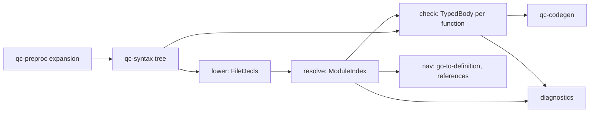

# The semantic model

How `crates/qc-sema` turns QuakeC source into what the editor, the language server and the
compiler know about a program: the definitions, what every name means, the type of every
expression, and every diagnostic. Read this before changing the crate; the module map at the
end says where each part of the language is handled.

## The one rule

**The semantic model does all the checking; the code generator only emits.** The design doc
("Compiler", One front end) requires that "the errors you see while typing are exactly the
errors the build reports". So every error and warning id's `qcc` and FTEQCC can raise about a
program is raised here, where the editor and the language server see it without a build.
`qc-codegen` receives a module with no errors and a typed body for every function, and turns
it into a progs; the only diagnostics it adds are the ones that need emitted code to decide
(the limits of the progs format: too many globals, fields, functions or statements).

## Prior art

Both reference compilers are one pass: `qcc`'s `PR_ParseDefs` and FTEQCC's `QCC_PR_ParseDefs`
read a declaration, look its names up, type each expression and emit its statements in one
walk, with the compiler's state in globals. That shape cannot serve an editor, which needs
the meaning of a file without compiling the module, recomputed per keystroke.

We follow rust-analyzer instead (`hir-def` lowering, `hir-ty` inference, salsa queries):

1. a lossless syntax tree per file (`qc-syntax`), which never fails;
2. **lowering** each file to plain data: its declarations and the bodies of its functions;
3. **resolution** of the module: one definition list in compilation order, every name use
   bound to a definition;
4. **checking** of each function body: the type of every expression and the diagnostics of
   expressions and statements, as `QCC_PR_Expression` and `QCC_PR_ParseStatement` check them;
5. a **query database** that memoizes each step per file, so a keystroke re-lowers one file
   and re-resolves only what it changes.

The behaviour of each step is FTEQCC's and `qcc`'s, cited statement by statement from
`docs/spec/`; only the structure is ours (ADR-0017, clean-port policy).

## The stages



| Stage | Reads | Produces | Owns the diagnostics of |
| --- | --- | --- | --- |
| `expand` | a module's files and `progs.src` order | each file's expanded text, its origin map back to the source, and the flags, warning settings and keywords in force at each offset | none (the preprocessor reports its own, QCD-8) |
| `lower` | one file's syntax tree | `FileDecls`: declarations, type declarations (structs, classes, enums, typedefs, accessors) and each function's `RawBody` | declarations malformed in themselves (a `typedef` that defines nothing) |
| `resolve` | every file's `FileDecls`, in compilation order | `ModuleIndex`: the definition list, the references, the facts of each definition | declarations, redeclarations, initialisers, types and type names, scopes and lookup (QCD-3, QCD-5.4, FTEF-17, FTEF-19) |
| `check` | the `ModuleIndex` and each body's syntax | a `TypedBody` per function: every expression with its type and the conversion applied | expressions, operators, calls, assignments, statements and control flow (QCD-4, FTEF-6.11 onward, the expression warnings of QCD-7) |
| `db` | file texts | the memoized results of each stage | none |

The order matters where FTEQCC's one pass makes it matter: a name resolves to what is
declared before it in compilation order (QC-12.5), and FTEQCC's flags and warning settings
can change between two lines of one function (FTEF-21). Every stage reads the settings in
force at the offset it is looking at, from `expand`'s per-offset tables, never a module-wide
value.

## Dialects: one implementation, named rules

There is one implementation with a profile, not a vanilla path and an FTEQCC path. Where the
dialects differ, the code asks the profile a named question:

```rust
if self.profile.locals_shadow_globals() { ... }      // FTE-22.1, vanilla QC-12.3
if self.profile.redeclaration_compares_defaults() { ... } // FTEF-19.6
```

`Profile` (`resolve/profile.rs`) holds the dialect and the module-wide options
(autoprototyping, case insensitivity, `qcfuncs`, the target format), and has one method per
behaviour that differs, each with its rustdoc citing both statements: what `qcc` does and what
FTEQCC does instead. A bare `if fteqcc` in a stage is a defect: name the rule.

Settings that change mid-file (`#pragma flag`, `#pragma warning`, `#pragma target`) are not
on the profile; they come from `expand`'s tables at the offset being read
(`Resolver::settle`, `Cx::flags_at`).

## Data

- **`Type`** (`ty.rs`): a QuakeC type as written and resolved: a simple type, a field of a
  type, a function, a pointer, or a name (a typedef, struct, class, enum or accessor) that
  `resolve` maps to what it names.
- **`Definition`, `DefId`, `Reference`** (`symbol.rs`): one entry of the definition list
  (QC-12.2) and one use bound to it.
- **`Facts`** (`resolve/facts.rs`): what FTEQCC keeps in its `def_t` beyond the definition:
  constness, array size, parameters, `static`, `shared`, `noref`, scope ends.
- **`TypeTable`** (`resolve/types/`): the typedefs, structs and unions, classes, enums and
  accessors the module declares, with their members, as `QCC_PR_ParseType` and its callers
  record them.
- **`TypedBody`** (`check/`): a function body's expressions in an arena, each with its type,
  the definition it names (if a name) and the cast or conversion `QCC_SupplyConversion`
  applied; the statements in order. It is what `qc-codegen` walks.

## Module map

Each module is a few hundred lines about one part of the language. Function bodies stay short
(`clippy::too_many_lines` and `clippy::cognitive_complexity` are denied in the crate, with the
thresholds in `clippy.toml`).

| Module | Holds | Ported from (FTEQCC; `qcc`) |
| --- | --- | --- |
| `lib.rs` | the crate's public surface | |
| `db.rs` | the query database: inputs, memos, `analyze_module` | |
| `expand.rs` | preprocessing a module and the per-offset settings tables | `QCC_main`'s file loop; `qcc.c` |
| `ty.rs`, `symbol.rs`, `nav.rs` | types, definitions and references, navigation queries | |
| `cast.rs` | the conversions and casts between kinds | `QCC_TryEvaluateCast`, `QCC_SupplyConversion` |
| `lower/mod.rs` | `FileDecls`, `lower_file` and the lowering context `Cx` | |
| `lower/decl.rs` | declarations, declarators, qualifiers, initialiser values | `QCC_PR_ParseDefs` (syntax side); `PR_ParseDefs` |
| `lower/types.rs` | struct, union, class, enum, typedef and accessor declarations | `QCC_PR_ParseType`, `QCC_PR_ParseStruct`, `QCC_PR_ParseEnum` |
| `lower/body.rs` | function bodies, statements and locals | `QCC_PR_ParseStatement` (syntax side) |
| `lower/expr.rs` | the names an expression uses | `QCC_PR_ParseValue` (syntax side) |
| `resolve/mod.rs` | `resolve_module`, the passes (autoprototyping) and `ModuleIndex` | `QCC_main`, `QCC_PR_FinishCompilation` |
| `resolve/profile.rs` | `Profile` and its named dialect rules | |
| `resolve/report.rs` | reporting under the warning settings in force | `QCC_PR_Warning`, `QCC_PR_ParseWarning` |
| `resolve/scope.rs` | the scopes and lookup of names | `QCC_PR_GetDef` (lookup); `PR_GetDef` |
| `resolve/global.rs` | declaring globals and redeclaration | `QCC_PR_GetDef` (declare), `typecmp`; `PR_GetDef` |
| `resolve/init.rs` | initialisers and constant values | `QCC_PR_ParseInitializerType`; `PR_ParseImmediate` |
| `resolve/types/` | typedefs, enums, structs and unions, classes, accessors | `QCC_PR_ParseType` and its callers |
| `resolve/body.rs` | parameters, locals, aliases, state headers and the uses of a body | `QCC_PR_ParseFunctionBody`, `QCC_PR_ParseState` |
| `check/mod.rs` | `TypedBody`, the `Env` the resolver gives the checks, checking one function or a global's initialiser | `QCC_PR_ParseImmediateStatements` |
| `check/expr.rs` | the checker, terms and binary operators: the type of each expression | `QCC_PR_RefTerm`, `QCC_PR_RefExpression` |
| `check/convert.rs`, `check/opcodes.rs` | the opcode table and the choice of an operator's opcode | `pr_opcodes`, `QCC_PR_ChooseOpcode`, `QCC_canConv` |
| `check/fold.rs`, `check/constant.rs` | constant values and their folding | `QCC_SRef_EvalConst`, `QCC_PR_StatementFlags` (folding) |
| `check/emulate.rs`, `check/pointer.rs`, `check/compare.rs` | opcodes the target lacks, pointer arithmetic, the comparison warnings, statements at global scope | `QCC_PR_StatementFlags` |
| `check/term.rs`, `check/truth.rs` | prefix operators, casts, vectors, `sizeof`, truth tests and `?:` | `QCC_PR_RefTerm`, `QCC_PR_GenerateLogicalNot`, `QCC_Generate_OP_IFNOT` |
| `check/reference.rs` | indexing, reads, addresses and stores to references | `QCC_PR_ParseRefArrayPointer`, `QCC_RefToDef`, `QCC_StoreSRefToRef` |
| `check/assign.rs` | assignments and compound assignments | `QCC_PR_RefExpression` (assignment), `QCC_StoreSRefToRef` |
| `check/member.rs`, `check/accessor.rs` | member access on entities, structs, classes, vectors and pointers; accessor members | `QCC_PR_ParseField`, `QCC_PR_BuildAccessorRef` |
| `check/call.rs`, `check/format.rs` | calls, arguments and intrinsics; the builtins whose arguments are checked | `QCC_PR_ParseFunctionCall`, `QCC_PR_GenerateFunctionCallRef`, `QCC_VerifyFormatString` |
| `check/statement.rs`, `check/flow.rs` | statements, and the layout of their jumps for missing returns and unreachable code | `QCC_PR_ParseStatement`, `QCC_CheckForDeadAndMissingReturns` |
| `check/vanilla.rs` | id's `qcc`'s checks under the vanilla profile | `PR_Expression`, `PR_Term`, `PR_ParseFunctionCall` |
| `resolve/types/layout.rs` | struct and union layout, `sizeof` | `QCC_PR_ParseStruct` |

[`docs/spec/inventory-l3.md`](../spec/inventory-l3.md) has a row for every function of
`qcc_pr_comp.c` and `pr_comp.c` and every diagnostic they raise, naming the module above that
owns it.

## Where a new check goes

1. Find the upstream function that raises it, and its row in `inventory-l3.md`. The row names
   the module.
2. Write the spec statement first (`docs/spec/`, with the C open), then a citing test in the
   module's tests, then the code.
3. If the dialects differ, add a named rule to `Profile`; do not branch on the dialect.
4. A declaration's check belongs to `resolve`; anything that needs the type of an expression
   belongs to `check`. Never approximate an expression's type in `resolve` from its shape.
5. Diagnostics are reported through `report`, which applies the warning settings in force.
