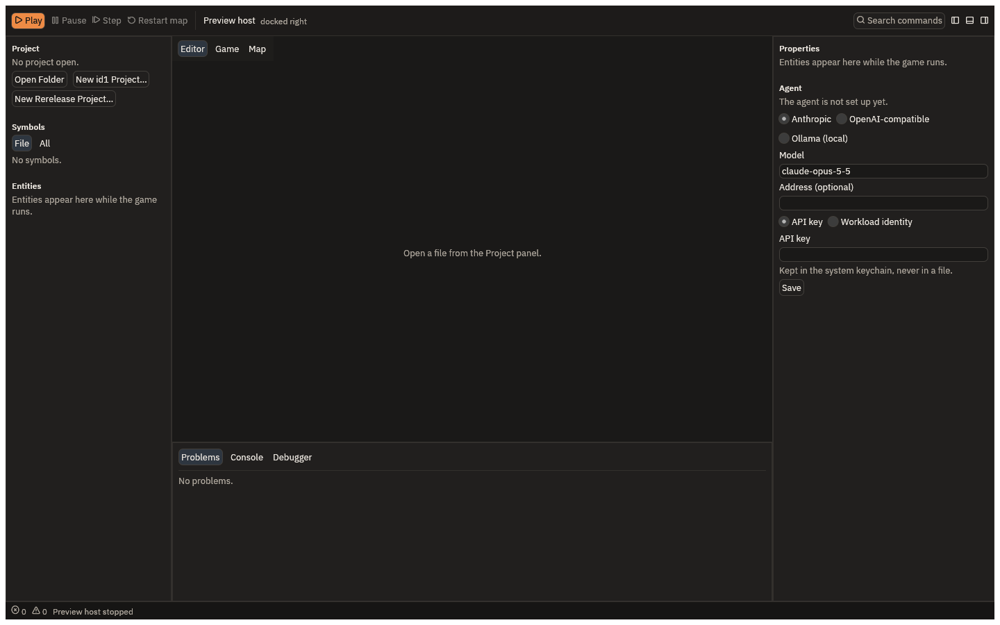

# Getting started

This page takes you from nothing to a mod of your own running in Quake, with a change you made
in it. It takes about ten minutes.

## 1. Have Quake

QuakeC Studio does not include Quake's game files. You need your own copy: the original game
or the 2021 rerelease, from Steam or GOG. The shareware episode works for the first episode
only. [Your Quake game data](../game-data.md) says what each version holds and how to get the
game onto a Mac, where the stores sell only the Windows version.

The IDE reads the game where it is installed and never copies it.

## 2. Start QuakeC Studio

Start the app. The window has the toolbar at the top, the Project and Entities panels on the
left, the editor in the centre, Properties and the agent on the right, and Problems, Console
and Debugger at the bottom.



## 3. Make a mod from a starter

With no project open, the Project panel offers **Open Folder**, **New id1 Project…** and
**New Rerelease Project…**. On macOS the same are in the File menu.

- **New id1 Project…** starts from id's QuakeC 1.01, the original game's code.
- **New Rerelease Project…** starts from the rerelease's QuakeC, for Quake's 2021 rerelease.

Choose the one that matches your copy of Quake, then name a new, empty folder. Its name is
your mod's name. The IDE downloads the starter's files from GitHub, at a pinned version,
checks each one, and opens the new project. This is the only time getting started uses the
network.

The new folder holds the starter's QuakeC and some files of its own:

- `quakec.toml`, which says the project's dialect and the engine it targets;
- `tests.qc`, with a sample unit test, and `tests/start.scenario`, a sample test played in the
  game;
- `.gitignore`, which keeps `build/`, the compiler's output, out of git;
- `COPYING` and `NOTICE.md`, the starter's license and where the code came from.

From the command line, `quakec-ide new id1 <folder>` does the same.

## 4. Play it

Press **Play** on the toolbar. The IDE builds the mod, and if it finds the game it starts it
in its own window, docked beside the IDE, on `start`, the map you begin Quake on.

If the IDE cannot find your game, it shows **Choose your Quake folder**. It says what the
folder it looked at holds and lacks. Press **Choose folder** and pick the folder that holds
`id1`. The IDE remembers it.

## 5. Change something

In the Project panel, open `weapons.qc`. Find `W_FireAxe`, the axe's attack, and the damage
line in it:

```c
T_Damage (trace_ent, self, self, 20);
```

Change `20` to `200` and save with Cmd+S. The running game reloads the new code at once,
without restarting the map. Hit a monster with the axe (type `impulse 1` in the game's console,
or press 1, to pick it): a grunt or a dog that took several blows now falls to one.

If the change has a mistake, the Problems tab lists it with its file and line, the toolbar
says **The reload failed; see the Console**, and the game keeps running the code it had.

## 6. Run the tests

Open the command palette with Cmd+Shift+P, type `test` and choose `project.test`, **Builds
the open project and runs its tests**. The project's tests are its `test_` functions and its
`tests/*.scenario` files. A new project has one of each, and both pass.

From the command line, `quakec-ide test <folder>` runs them too.

## Next

- [The play loop](play-loop.md) says more about Play, Pause, Step and reloading.
- [The agent](agent.md) shows how to ask the agent for a change like the one above.
