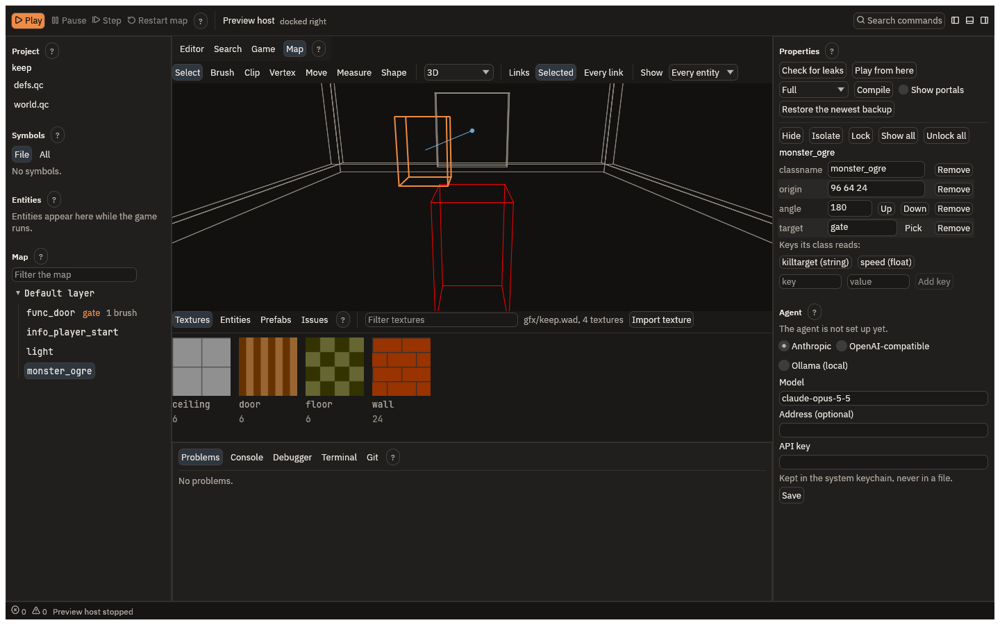
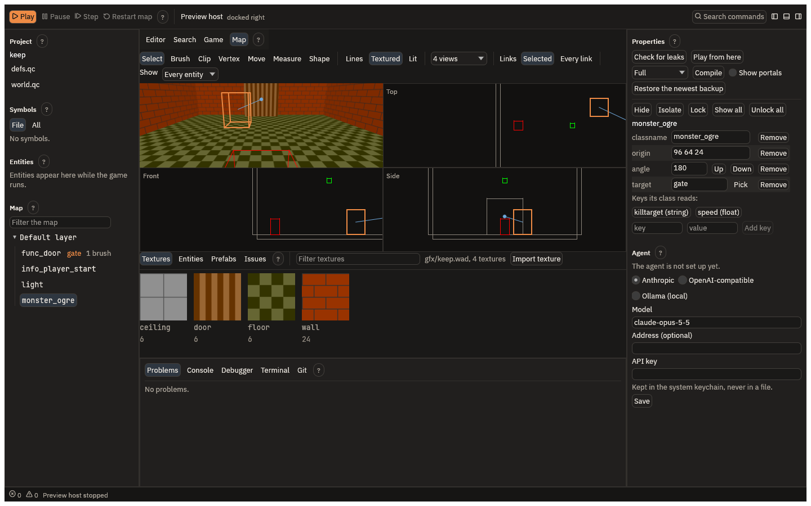
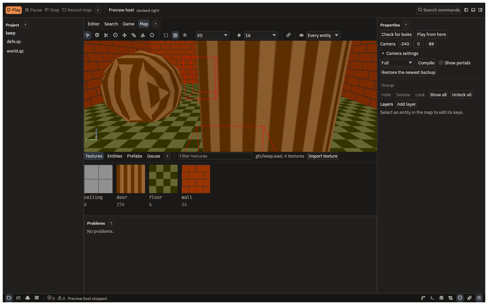
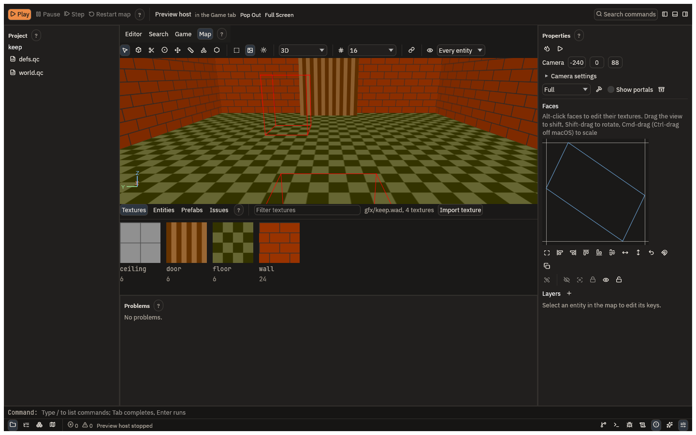
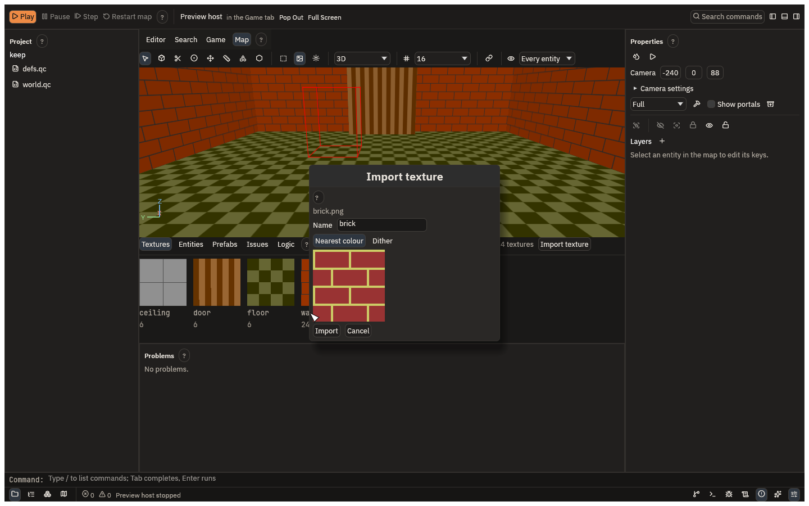
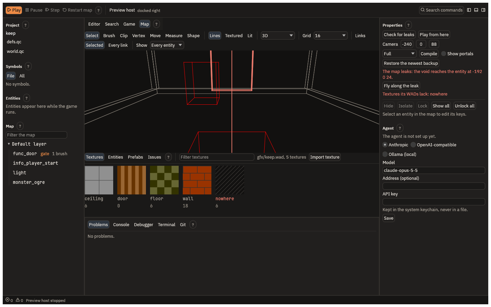
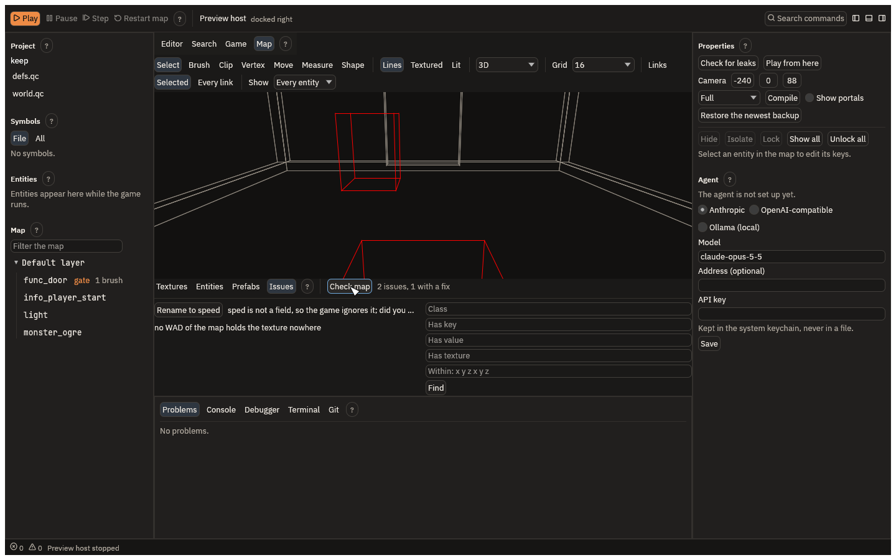

# The map editor

This page takes you through building a map in QuakeC Studio: opening one, editing its entities
and brushes, giving it textures, compiling it, finding a leak, and playing it from where you
stand. Everything here works offline.

## 1. Set up once

You need a project open (see [Getting started](getting-started.md)) and your own copy of Quake.
The map editor reads the game where it is installed and never copies it.

- **The game.** Press **Play** once. If the IDE cannot find your game, it shows **Choose your
  Quake folder**, says what the folder it looked at holds and lacks, and **Choose folder** picks
  the folder that holds `id1`. The IDE remembers it. [Your Quake game data](../game-data.md)
  says which versions work.
- **The textures.** A map names its WAD files in the world's `wad` key, as id's tools and
  ericw-tools read it. The texture browser lists the textures of every WAD the map names, found
  in the project, beside the map, or in the game folder. A texture no WAD holds is drawn with a
  stand-in and its name shown in red, with **No WAD the map names holds this texture**.

## 2. Open a map

In the Project panel, click a `.map` file. It opens in the **Map** tab in the centre: the 3D
view, the toolbar above it, and the Textures, Entities, Prefabs and Issues tabs below it. The
**Map** panel on the left lists the map's layers and entities; the **Properties** panel on the
right edits the selection. A `.bsp` with no `.map` opens too, to look at, but cannot be
compiled.

**Moving around.** Drag the 3D view to turn and scroll to move. With the view focused, W, A, S
and D fly forward, left, back and right, and Q and X fly up and down, as in TrenchBroom. The
layout picker beside **Select** shows the 3D view alone, **3D + top**, or **4 views**: 3D, top,
front and side.

## 3. Edit entities

Click an entity in the view, or its row in the Map panel, to select it. **Properties** shows
its keys:

- Edit a value in place, and **Remove** takes a key away.
- **Keys its class reads** lists the keys its QuakeC class uses, with their types, read from
  your mod's code. Click one to add it.
- **Add key** adds any other key and value.
- For a `target` or `killtarget`, **Pick** lets you click the entity it should fire, or
  Alt-drag from the selection onto it. **Links** in the toolbar draws the lines between
  entities that target each other, for the selection or for every entity.

To place a new entity, open the **Entities** tab below the view and drag a class into the map.
The classes are your mod's, read from its QuakeC.

With an entity selected in the 3D view, the arrow keys and Page Up and Page Down move it by the
grid, Alt with Left or Right turns it, Delete deletes it, and Cmd+D duplicates it. Cmd+S saves
the map.

**Hide**, **Isolate**, **Lock**, **Show all** and **Unlock all** in Properties act on the
selection, and **Show** in the toolbar filters the entities by skill, coop and deathmatch.

## 4. Build with brushes

The toolbar's tools make and change brushes:

- **Brush**: drag on the ground to draw a box.
- **Shape**: drag a box to fill it with a shape: a cylinder, cone, arch, UV sphere,
  icosphere, rock, scalable curve, stairs or spiral stairs, solid or hollow.
- **Clip**: select a brush, then drag the cut line; keep the part on either side.
- **Vertex**: move a brush's corners, split its faces and edges, extrude or chamfer.
- **Move**: select brushes, then drag to move them.
- **Measure**: drag from one point to another to read the distance.

With brushes selected, **Brushes** in Properties offers **Subtract**, **Merge**,
**Intersect**, **Delete brush**, scaling and shearing.

**Textures.** Click a texture in the **Textures** tab to choose it; with brushes selected,
**Apply** and the texture's name in Properties paints them with it. Alt-click
faces in the view to select them alone; then drag the view to shift their texture, Shift-drag to
rotate it and Cmd-drag to scale it. **Fit**, the justify buttons, **Flip S** and **Flip T**,
**Reset**, **Copy alignment** and **Paste alignment** act on the selected faces. **Texture lock**
keeps textures in place as brushes move.

To bring in a texture of your own, drop a PNG on the window while the Textures tab shows, or
press **Import texture**. The IDE maps its colours to Quake's palette, with **Nearest colour** or
**Dither**, writes it into the project's own WAD in `textures/`, and names that WAD in the map's
world.

**Prefabs.** Select brushes and entities and **Save as prefab** to keep them in the project's
`prefabs` folder; drag a prefab from the **Prefabs** tab into the view to copy it in.

## 5. Compile

The compile controls are at the top of Properties:

- **Compile** builds the map with the profile chosen beside it. **Full** runs the BSP, full vis
  and full light; **Fast** runs fast vis and fast light. A project can add its own profiles in
  `compile-profiles.toml`.
- **Check for leaks** compiles the map in memory and says whether it leaks.
- **Show portals** draws where the map's leaves meet, from the last compile.

The compilers are QuakeC Studio's own, built into the app and checked against id's tools and
ericw-tools. Coloured lights, with a `_color` key, write a `.lit` beside the BSP.

## 6. Find a leak

A map leaks when an entity can reach the void through a gap in the world's brushes. **Check for
leaks** says which entity the void reaches, draws the trail from it to the outside in the view,
and **Fly along the leak** takes the camera along the trail to the gap. It also lists the
textures the map's WADs lack.

When the map is sealed, it says **The map is sealed: no entity is in reach of the void.**

The **Issues** tab's **Check map** lists the map's other problems, checked against your mod's
QuakeC: a key no field of its class reads, such as a misspelled `speed`, and a missing texture.

## 7. Play from here

**Play from here** compiles the map fast, with no vis and fast light, starts the game on it, and
puts you where the 3D view's camera is, facing its way. If the camera is in a wall or in the
air, the player is moved up or down to the nearest place they fit. Walk around, then come back
to the editor, change something and press it again.

## 8. If something goes wrong

The editor keeps a backup of the open map every minute while it has unsaved edits, and one each
time you save, in an `autosave` folder beside the map; the last 20 are kept. **Restore the
newest backup** puts the latest one in the editor as an edit, which Cmd+Z takes back.

If the file changes on disk while you have edits, the editor asks: **Reload from disk**, **Keep
mine**, or **Compare** to see the difference.

## Next

- [The play loop](play-loop.md): change your mod's QuakeC while the map runs.
- [Debugging](debugging.md): stop the running game at a line of your code.
- [Commands](../commands.md): every `map.*` command, which the agent, MCP and the CLI share.
