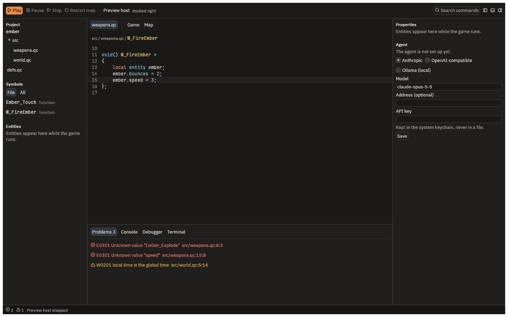

# Opening a mod

QuakeC Studio opens a folder of QuakeC as a project: a mod you have, a mod you downloaded,
or the starter you made in [Getting started](getting-started.md).

## Open a folder

Choose **Open Folder** in the Project panel (on macOS, File > Open Folder…), or start the app
with the folder on the command line:

```bash
quakec-studio /path/to/your/mod
```

The panel lists the projects you opened recently; a click opens one again.

The folder is a project when it holds one of these:

- a `quakec.toml`, which names each of the project's programs (its modules), their dialect
  and their target engine;
- a `progs.src`, the file list id's compiler reads, and optionally a `csprogs.src` for client
  QuakeC.

A folder with only a `progs.src` opens in the **vanilla** dialect, the QuakeC id's compiler
reads. A mod written for FTEQCC, the compiler most mods use today, needs a `quakec.toml` that
says so, or `--dialect fteqcc` on the command line. The starters write their `quakec.toml`
for you.

## What you see



- **Project** lists the files the project compiles, in the order the compiler reads them, as
  a tree.
- **Symbols** lists the open file's functions, globals and fields; **All** lists every file's.
- **Problems**, at the bottom, lists every error and warning with its code, message and place.
  The status bar counts them. A click opens the file at that place.
- The **editor** colours each name by what it is: a function, a field, a global, a local.

The project is checked as you type, about a third of a second after you stop, so the Problems
list follows the text on screen even before you save.

## Moving around the code

| Key | What it does |
| --- | --- |
| Cmd+Shift+P | The command palette: every command the IDE has, searched by name |
| F12 | Go to the definition of the name under the caret |
| Shift+F12 | List the references to it; a click opens one |
| F2 | Rename it everywhere |
| Ctrl+Space | Complete the name being typed |
| Cmd+F | Find and replace in the file |
| Cmd+S | Save |
| Cmd+1, Cmd+2, Cmd+3, Cmd+4 | Give the keyboard to the editor, the left, right or bottom panel |

Resting the pointer on a name shows its declaration.

To change a shortcut, write `keymap.toml` in the app's config folder (on macOS
`~/Library/Application Support/QuakeC Studio`, on Windows `%APPDATA%\QuakeC Studio`, on Linux
`~/.config/quakec-studio`). Each binding names its keys and a command from the palette:

```toml
[[binding]]
keys = "secondary-shift-b"
command = "project.build"
```

`secondary` is Cmd on macOS and Ctrl elsewhere. The change takes effect at once.

To edit with Vim's keys, add this to `settings.toml` in the same folder and start the app again:

```toml
[editor]
key_mode = "vim"
```

The editor starts in Normal mode, with Vim's motions, operators, counts, registers and `.`.

## Building

Play builds before it starts the game, so most of the time you never build by hand. To build
alone, run `project.build` from the palette, or from the command line:

```bash
quakec-ide build /path/to/your/mod
```

The output goes to `build/<mod>/progs.dat` inside the project, never into your Quake folder.

## Exporting for players

**File > Export Mod…** (on Windows and Linux, **Export Mod…** on the toolbar) builds the project
and writes `build/<mod>.zip`, which players unzip into their Quake folder. The status bar says
where it is. The zip holds the `<mod>` folder:

- `progs.dat`, and `csprogs.dat` or `menu.dat` when the project has them;
- everything under the project's `maps`, `progs`, `sound`, `gfx`, `music`, `textures` and `env`
  folders, except `.map` sources;
- a `README.txt` that says which game the mod needs and how to install and start it;
- the project's license and notice files, such as `COPYING`, `LICENSE` or `NOTICE.md`.

It never includes id Software's game data. A file that is a copy of one of the game's own
files is refused with its name, so remove it from the project. To pack the assets into
`pak0.pak`, run `project.export` from the palette with `pak` checked. From the command line:

```bash
quakec-ide run project.export '{}' --project /path/to/your/mod
```
