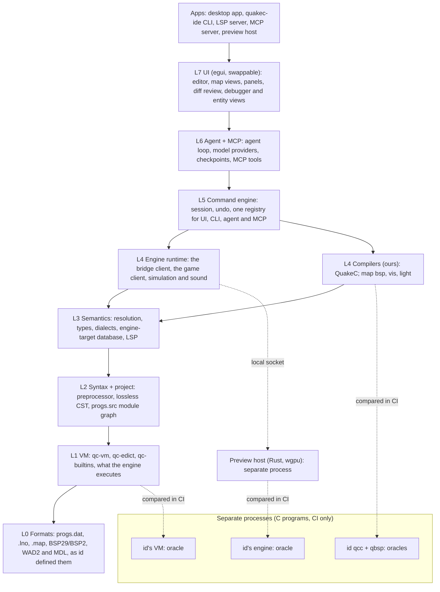

# Layers

QuakeC Studio's crates sit in layers L0 to L7 plus `apps`, from id's file formats at the bottom
to the UI and the binaries at the top (ARCH-1, [design doc](design/design-doc.md#architecture)).
A crate may depend only on crates in its own layer or a lower one, so the foundations never
learn about the editor above them and each layer can be tested, and pass its readiness review
([`testing.md`](testing.md)), before anything builds on it.

*The diagram is the one in the design doc. Arrows point down to what a layer uses; the C
oracles are separate processes, not crates, and are not layered. The preview host is an `apps`
binary that runs as its own process.*

| Layer | What it holds |
| --- | --- |
| L0 formats | progs.dat, .lno, PAK and WAD2, .map, BSP29/BSP2, MDL; shared foundations such as `qs-paths` |
| L1 VM | qc-vm, qc-edict, qc-builtins: what the engine executes |
| L2 syntax | Preprocessor, lossless CST, progs.src project graph |
| L3 semantics | Resolution, types, dialects, engine-target database, LSP, map entity definitions |
| L4 bridges | Our QuakeC compiler and our map compilers (bsp, vis, light); the engine bridge and its client; the preview host's game client, simulation and sound |
| L5 commands | Command engine, session, undo: one registry for UI, CLI, agent and MCP; the workbench, layout, settings and templates the commands act on |
| L6 agent | Agent loop, model providers, checkpoints, MCP and ACP |
| L7 UI | The app on the chosen framework: the code editor view and the wgpu renderer |
| apps | Desktop app, CLI, LSP server, preview host |

## The crates

Every workspace crate and its layer, written from [`layers.toml`](../layers.toml) and each
crate's package description by `cargo xtask layers --write`. `cargo xtask layers` fails when
the table is not what they render, so this is the one list of crates to read; a crate's
README says more.

<!-- crates:start (generated by cargo xtask layers --write; do not edit by hand) -->
| Layer | Crate | What it is |
| --- | --- | --- |
| L0 | `qc-diag` | The one QuakeC diagnostic type: a code from docs/spec/language-diagnostics.md, a message and a byte span, shared by the editor, LSP, CLI and compiler |
| L0 | `qc-lno` | Reader and writer for the .lno statement-to-source-line map beside a progs.dat |
| L0 | `qc-progs` | Zero-copy progs.dat reader, writer and validation, for id's version 6 and FTE's version 7 |
| L0 | `qc-types` | The eight QuakeC types, their slot layout, typed values and the reserved global slots |
| L0 | `qs-bsp` | BSP29, BSP2 and .lit readers: id's Mod_LoadBrushModel with bounds checks, and entity lump writing for maps with no .map source |
| L0 | `qs-checkpoint` | Checkpoints of a project's files as git objects on private refs, in the project's git directory or a hidden store, and their restore, deletions included |
| L0 | `qs-diff` | Line diffs: the shortest edit script between two lists of lines (Myers), the inline diff an editor shows and the hunks staged edits are reviewed by |
| L0 | `qs-git` | Git in the window: status, hunks to stage and unstage, commits, branches, file history, blame and merge conflicts, through the git command line |
| L0 | `qs-install` | Finds the user's Quake game data from Steam, GOG and Heroic, checks it by checksum, and links it into run roots |
| L0 | `qs-log` | Crash-safe logging for QuakeC Studio: a per-OS log directory, rotation and redaction of source text |
| L0 | `qs-map` | Lossless .map reader and writer (standard and Valve 220), and a model of what id's qbsp reads from a .map |
| L0 | `qs-mdl` | Models: id's alias model and sprite loaders (Mod_LoadAliasModel, Mod_LoadSpriteModel) with bounds checks, the rerelease's MD5 meshes and animations, and alias models written and made as id's modelgen does |
| L0 | `qs-pak` | PAK archive reader: id's COM_LoadPackFile with bounds checks, in memory or from a seekable file |
| L0 | `qs-paths` | The one place QuakeC Studio decides where its files live on each OS |
| L0 | `qs-vfs` | The game filesystem: id's search path of game directories and PAK archives, and file lookup on it |
| L0 | `qs-wad` | WAD2 reader and writer: id's W_LoadWadFile and W_GetLumpinfo with bounds checks, the lump layouts, and textures quantized to the palette |
| L0 | `qs-wav` | WAV reader: id's GetWavinfo and the sounds S_LoadSound plays, loop points included, with bounds checks |
| L1 | `qc-builtins` | The vanilla QuakeC builtins and a deterministic mock engine for them, over qc-vm's Builtins trait |
| L1 | `qc-edict` | The server's edict store: entity memory, field access, spawn and remove, and the system globals and fields |
| L1 | `qc-trace` | The shared per-statement VM trace format, with its binary and JSON encoders and decoders |
| L1 | `qc-vm` | The QuakeC virtual machine: id's PR_ExecuteProgram as a no-panic interpreter over a loaded progs.dat |
| L1 | `qs-porting-example` | Worked example of the porting process: id's ED_NewString ported to Rust |
| L2 | `qc-lexer` | The QuakeC lexer, for id's qcc and the FTEQCC dialects: tokens with byte spans, frame macro commands and lexical diagnostics |
| L2 | `qc-preproc` | The QuakeC preprocessor: #include, #define, #ifdef, frame macros, and expansions mapped back to source spans |
| L2 | `qc-project` | QuakeC projects: quakec.toml, bare progs.src projects, and each module's ordered file graph |
| L2 | `qc-syntax` | The QuakeC parser, for id's qcc and the FTEQCC dialects: a lossless, error-tolerant concrete syntax tree and a typed AST view |
| L3 | `qc-engines` | The engine-target database: which builtins and extensions each Quake engine supports, and the missing-builtin diagnostic |
| L3 | `qc-entities` | The entity classes a QuakeC module defines, their FGD export, and a map's entities checked against the progs |
| L3 | `qc-ide` | The editor features of QuakeC Studio over the semantic model: navigation, rename, hover, completion, highlighting, inlay hints and diagnostics, with no protocol |
| L3 | `qc-sema` | The incremental QuakeC semantic model: name resolution, types, and per-module symbol tables on salsa-style queries |
| L4 | `qc-codegen` | The QuakeC compiler's code generator: lowers the semantic model to a version 6 progs.dat |
| L4 | `qs-bots` | Bots for the preview host: a client's moves each server frame from what it sees, played by the mod's own player QuakeC |
| L4 | `qs-bridge` | The IDE bridge protocol: framing, JSON-RPC messages, the session and its schemas, shared by the preview host and the IDE's client |
| L4 | `qs-client` | The preview host's client: the server's messages read into entities, lights, particles, the view and the status bar, as id's cl_*.c, r_part.c, view.c and sbar.c keep them |
| L4 | `qs-engine` | The IDE's client for the preview host: run roots, launching the host and the bridge protocol |
| L4 | `qs-map-bsp` | The map compiler: a .map to a BSP29 file, its portal file and its leak file, as id's qbsp builds them |
| L4 | `qs-map-gen` | The level maker: a random playable map from a seed, its rooms and passages taken out of solid blocks |
| L4 | `qs-map-light` | The light compiler: each face's lightmaps from the map's lights, as id's light finds them in the id dialect and as ericw-tools' light does in the extended one |
| L4 | `qs-map-vis` | The visibility compiler: each leaf's potentially visible set and ambient sound levels, as id's vis finds them |
| L4 | `qs-sim` | The preview host's server simulation: a map's entities spawned through the progs, and the world they live in |
| L4 | `qs-sound` | The preview host's sound engine: channels, spatialization, ambient and static sounds, and the mixer, as id's snd_dma.c and snd_mix.c play them |
| L5 | `qs-commands` | The QuakeC Studio command engine: one registry of commands with stable ids, JSON Schema parameters, undo steps and a panic guard |
| L5 | `qs-layout` | The workbench layout: which panels are shown and their sizes, kept across restarts, and the commands that change it |
| L5 | `qs-map-edit` | Map editing: the open map, its entities, brushes, textures and layers, and the map commands that need no QuakeC |
| L5 | `qs-settings` | QuakeC Studio settings: user and project settings files, their schema, and the commands that read and change them |
| L5 | `qs-templates` | New-project templates: starters from id's QuakeC, fetched by commit under their GPLv2 terms and checked by SHA-256, with quakec.toml and a sample test |
| L5 | `qs-update` | The update check: the release feed read with one request, the version compared, and the install's own way to update found from how it was installed; nothing is downloaded or installed |
| L5 | `qs-workbench` | The open project and file: the file tree, symbols and problems the panels list, and the commands that open a project or a file |
| L6 | `qs-acp` | The ACP client: an external agent (Claude Code, Codex and others) run as a subprocess and spoken to over the Agent Client Protocol on stdio |
| L6 | `qs-agent` | The agent loop: plan, edit, compile, test and propose over the command registry, a run done only when the compile is clean and its tests pass |
| L6 | `qs-mcp` | The MCP server: the agent's tools, the IDE's commands, offered to other agents over the Model Context Protocol on stdio, within read and write roots |
| L6 | `qs-models` | The agent's model providers: Anthropic, OpenAI-compatible endpoints and Ollama, with API keys kept in the OS keychain |
| L7 | `qs-editor-view` | The code editor widget: virtualised lines with a per-line layout cache, selections and multiple carets, IME composition and AccessKit text runs, on egui |
| L7 | `qs-game` | The preview host's game: its loop on qs-sim, qs-client, qs-render and qs-sound, its window and its bridge server, as a library the host and the IDE both run |
| L7 | `qs-render` | The wgpu renderer: a BSP's world surfaces with their textures and lightmaps, drawn through egui_wgpu paint callbacks |
| apps | `quakec-engine` | The preview host: the game in its own window, our engine on qs-sim, qs-render and qs-sound, with the IDE bridge server |
| apps | `quakec-ide` | QuakeC Studio's command line: build and check a QuakeC project, and run any command of the IDE by its id |
| apps | `quakec-lsp` | The QuakeC language server: QuakeC Studio's editor features over the Language Server Protocol, for VS Code, Zed, Neovim and other editors |
| apps | `quakec-studio` | QuakeC Studio, the desktop app: the window, its toolbar and its docked panels, on egui |
| tests | `qs-bench` | The QuakeC Studio performance-budget benchmarks, run by cargo xtask bench |
| tests | `qs-differential` | The QuakeC Studio side of the differential VM runner: reads a scenario, drives qc-vm, compares its trace against the id VM oracle |
| tests | `qs-tests` | The single integration test binary for tests that span several QuakeC Studio crates |
| tooling | `xtask` | QuakeC Studio build automation, run as cargo xtask |
<!-- crates:end -->

## The rules

`cargo xtask layers` reads [`layers.toml`](../layers.toml) and every workspace member's
`Cargo.toml`, and fails when:

1. a workspace crate is missing from `layers.toml`;
2. `layers.toml` names a crate that is not a workspace member, or a layer that does not exist;
3. a crate depends on a crate in a higher layer. The message names both crates and their
   layers, for example `qs-vm (L1) depends on qs-sema (L3)`;
4. the crate table above is not the one `layers.toml` and the crates' descriptions render.

Normal, dev and build dependencies all count, including target-specific ones and renamed ones
(`package = "..."`), so a test cannot reach up a layer either. Tests that need several layers
belong in `qs-tests` ([`conventions.md`](conventions.md#tests-conv-11)).

**Same layer.** A crate may depend on another crate in its own layer. L1 is three crates that
build on each other (`qc-builtins` calls into `qc-vm`), so "lower layers only" is read as "no
higher layer". Cargo already rejects cycles between crates.

**Outside the ranking.** Two kinds of crate are not part of the product's stack and take the
layer names `tests` and `tooling` instead of L0 to L7 or `apps`:

| Layer | Holds | Rule |
| --- | --- | --- |
| `tests` | The single cross-crate integration test binary, the performance-budget benchmarks and the differential VM harness | may depend on any crate |
| `tooling` | Build automation | may depend on any crate |

No crate may depend on a `tests` or `tooling` crate.

## Adding a crate

Add the crate under `crates/` or `apps/`, give it a line in `layers.toml` and a `description`
in its `Cargo.toml`, and run `cargo xtask layers --write`, all in the same PR.
Pick the lowest layer whose crates it needs; if it needs a higher layer than its purpose
suggests, the design is wrong, not the layer.
