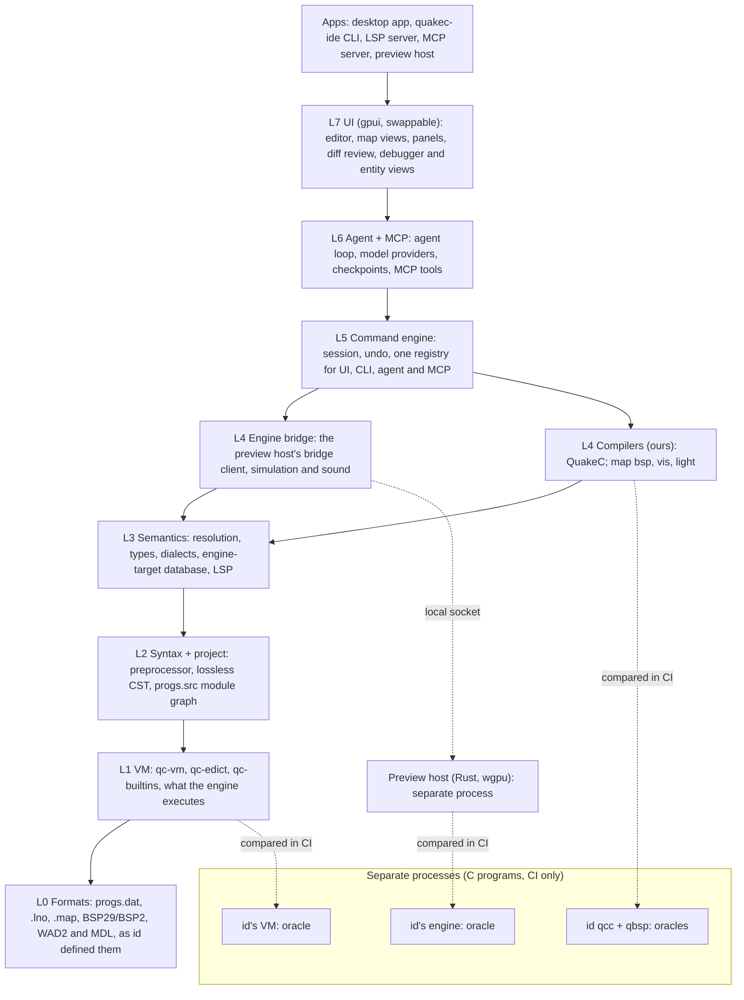

# Layers

QuakeC Studio's crates sit in layers L0 to L7 plus `apps`, from id's file formats at the bottom
to the UI and the binaries at the top (ARCH-1, [design doc](design/design-doc.md#architecture)).
A crate may depend only on crates in its own layer or a lower one, so the foundations never
learn about the editor above them and each layer can be tested, and pass its readiness review
([`testing.md`](testing.md)), before anything builds on it.

*The diagram is the one in the design doc. Arrows point down to what a layer uses; the C
oracles are separate processes, not crates, and are not layered. The preview host is an `apps`
binary that runs as its own process.*

| Layer | What it holds |
| --- | --- |
| L0 formats | progs.dat, .lno, PAK and WAD2, .map, BSP29/BSP2, MDL; shared foundations such as `qs-paths` |
| L1 VM | qc-vm, qc-edict, qc-builtins: what the engine executes |
| L2 syntax | Preprocessor, lossless CST, progs.src project graph |
| L3 semantics | Resolution, types, dialects, engine-target database, LSP, map entity definitions |
| L4 bridges | Our QuakeC and map compilers; the engine bridge client; the preview host's simulation (`qs-sim`) and sound (`qs-sound`) |
| L5 commands | Command engine, session, undo: one registry for UI, CLI, agent and MCP |
| L6 agent | Agent loop, model providers, checkpoints, MCP and ACP |
| L7 UI | The app on the chosen framework; the wgpu renderer (`qs-render`) |
| apps | Desktop app, CLI, LSP server, preview host |

## The rules

`cargo xtask layers` reads [`layers.toml`](../layers.toml) and every workspace member's
`Cargo.toml`, and fails when:

1. a workspace crate is missing from `layers.toml`;
2. `layers.toml` names a crate that is not a workspace member, or a layer that does not exist;
3. a crate depends on a crate in a higher layer. The message names both crates and their
   layers, for example `qs-vm (L1) depends on qs-sema (L3)`.

Normal, dev and build dependencies all count, including target-specific ones and renamed ones
(`package = "..."`), so a test cannot reach up a layer either. Tests that need several layers
belong in `qs-tests` ([`conventions.md`](conventions.md#tests-conv-11)).

**Same layer.** A crate may depend on another crate in its own layer. L1 is three crates that
build on each other (`qc-builtins` calls into `qc-vm`), so "lower layers only" is read as "no
higher layer". Cargo already rejects cycles between crates.

**Outside the ranking.** Two kinds of crate are not part of the product's stack and take the
layer names `tests` and `tooling` instead of L0 to L7 or `apps`:

| Layer | Crates | Rule |
| --- | --- | --- |
| `tests` | `qs-tests`, the single cross-crate integration test binary | may depend on any crate |
| `tooling` | `xtask` | may depend on any crate |

No crate may depend on a `tests` or `tooling` crate.

## Adding a crate

Add the crate under `crates/` or `apps/` and give it a line in `layers.toml` in the same PR.
Pick the lowest layer whose crates it needs; if it needs a higher layer than its purpose
suggests, the design is wrong, not the layer.
