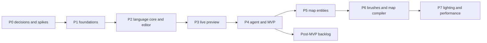

# Roadmap

How QuakeC Studio gets built, from an empty repo to the MVP and then the map editor. The [design document](design/design-doc.md) says what we are building and why; the [plan](../plan/README.md) holds every requirement and issue as data; this page is the map between them. Read it before picking up an issue.

## What we are building

A native Rust IDE for QuakeC on macOS, Windows and Linux. A modder edits code, presses Play and sees the change in the running game in about a second; pauses the game, clicks an entity and inspects or edits its fields; asks the built-in agent for a change and reviews it as a diff before anything touches disk. The IDE compiles QuakeC itself, with no outside toolchain, and later edits and compiles maps too.

**The MVP** is done when a modder can open id's 2021 rerelease QuakeC, ask the agent for a new weapon, review the diff, and see it fire in a live game on all three operating systems, from signed builds.

## Decisions so far

| Decision | Where it lives |
| --- | --- |
| Rust, one codebase, signed native builds for macOS (universal), Windows and Linux | Design doc: Summary; GOAL-6 |
| Feel like Zed's editor with Roblox Studio's play loop, not like Cursor: the running game is the product, code serves it | Design doc: Product principles; UI-14 |
| Our own QuakeC compiler, no outside toolchain at runtime | Design doc: Compiler; GOAL-2 |
| Foundations built from id's GPL Quake source as the spec, through a clean-room process; id's VM and qcc run only as out-of-process test oracles, never linked | Design doc: Source and licensing; LIC-1 to LIC-3; [#8](https://github.com/quakecstudio/editor/issues/8), [#9](https://github.com/quakecstudio/editor/issues/9) |
| Live preview through our own preview host (a small GPL QuakeSpasm-lineage fork with an IDE bridge), plus adapters for FTEQW and restart-loop engines; v1 docks the engine window beside the IDE, embedding comes later | Design doc: Engine bridge; ENG-1 to ENG-14 |
| The agent is a client of the same command registry as the UI and the CLI; exposed over MCP; external agents run in the panel over ACP | Design doc: Agent harness; PRIN-3, PRIN-6 |
| A map editor and our own map compiler, after the MVP (Phases 5 to 7) | Design doc: Map editor; MAP-18 |
| Rust conventions follow vouch | [`conventions.md`](conventions.md) |
| A layer's dependants wait until its test suite passes the readiness bar | [`testing.md`](testing.md) |
| The visual design and mockups | [`design/`](design/README.md); approved on [#199](https://github.com/quakecstudio/editor/issues/199) |

Still open, all in Phase 0: the license model ([#8](https://github.com/quakecstudio/editor/issues/8)), the UI framework ([#10](https://github.com/quakecstudio/editor/issues/10), gpui recommended), the preview host base ([#12](https://github.com/quakecstudio/editor/issues/12)) and default target ([#14](https://github.com/quakecstudio/editor/issues/14)), the product name ([#15](https://github.com/quakecstudio/editor/issues/15)), the MVP scope ([#21](https://github.com/quakecstudio/editor/issues/21)) and the game directory strategy ([#22](https://github.com/quakecstudio/editor/issues/22)).

## How the code is layered

Each layer may depend only on layers below it; `cargo xtask layers` enforces this once [#2](https://github.com/quakecstudio/editor/issues/2) lands.

| Layer | What it holds |
| --- | --- |
| L0 formats | progs.dat, .lno, PAK and WAD2, .map, BSP29/BSP2, MDL |
| L1 VM | qc-vm, qc-edict, qc-builtins: what the engine executes |
| L2 syntax | Preprocessor, lossless CST, progs.src project graph |
| L3 semantics | Resolution, types, dialects, engine-target database, LSP, map entity definitions |
| L4 bridges | Our QuakeC and map compilers; the engine bridge and adapters |
| L5 commands | Command engine, session, undo: one registry for UI, CLI, agent and MCP |
| L6 agent | Agent loop, model providers, checkpoints, MCP and ACP |
| L7 UI | The app on the chosen framework |
| apps | Desktop app, CLI, LSP server |

GPL code lives in separate repositories and runs as separate processes: `quakecstudio/oracles` (id's VM trace harness, id's qcc, a pinned FTEQCC, later id's map tools and ericw-tools; CI only) and `quakecstudio/preview-host` (the engine fork with the IDE bridge).

## The phases

Phases run in order. Each ends with a gate review issue, and every issue in a phase depends on the previous gate. Inside a phase, an issue that builds on a lower layer also waits for that layer's readiness review.

| Phase | What gets built | Gate |
| --- | --- | --- |
| **0. Decisions and spikes** | The repo, `cargo xtask ci`, CI on three OSes, the ADR and clean-room processes, the readiness tooling, the license and UI framework decisions, the visual design | UI framework, license model and visual design chosen; repo, CI and planning in place |
| **1. Foundations** | Clean-room specs, then qc-types, qc-progs, qc-edict, qc-vm and qc-builtins; the GPL oracle repo and a differential runner that compares our VM to id's statement by statement; PAK/WAD2 and install detection; the lexer, preprocessor and lossless parser, fuzzed | qc-vm matches id's VM on the id 1.01 and rerelease corpus; the parser round-trips it losslessly |
| **2. Language core and editor** | The incremental semantic model, dialects and engine-target database; our compiler (vanilla, then the rerelease's FTEQCC features) with differential and conformance suites; the command engine; CLI, LSP and tree-sitter grammar; the app shell, code editor, panels and command palette to the approved mockups | The rerelease compiles with our compiler and behaves identically in qc-vm; full navigation and clean diagnostics in the editor |
| **3. Live preview** | The bridge protocol; the preview host fork with hot reload, debugging and headless mode; engine adapters; the play toolbar, Entities, Properties, Debugger and Console; docking the engine window; deterministic scenarios | Save-to-game in about a second on all three OSes, with breakpoints and entity inspection |
| **4. Agent and MVP** | Agent tools as commands, staged edits and hunk review, checkpoints, the agent loop and providers, the agent panel, inline edit, next-edit suggestions, MCP and ACP, evals; privacy audit, signing and packaging, docs, legal review of the GPL boundary | The MVP demo on three OSes; signed builds published |
| **5. Map entity editing** | Map and BSP formats, entity definitions derived from QuakeC, the wgpu renderer, the map view with entity editing, live entity updates, agent map tools | Entities in existing maps are edited with QuakeC-derived definitions and appear live in the game |
| **6. Brushes and map compiler** | Clean-room specs and our qmap-bsp, qmap-vis and fast qmap-light, checked against id's tools and ericw-tools; brush tools, 2D views, texture browser, leak diagnostics, play from here | A new map built from brushes compiles with our tools and plays, matching id's tools on the map corpus |
| **7. Lighting and performance** | Full coloured lighting, background full compile, region compile, compile performance | Lighting, region compile and background compile meet the performance budgets |
| **Post-MVP** | GMQCC, CSQC and MenuQC, full FTEQCC code generation, optimizations, a DarkPlaces adapter, the embedded game view, a web build, advanced lighting | Each item is scheduled into a phase by an ADR first |

The [project board](https://github.com/orgs/quakecstudio/projects/1) has the live state; its Roadmap view groups the issues by phase.

## Where we are

Phase 0. The plan, the issues, the board, the design document and the approved mockups exist; there is no code yet.

Two tracks run in parallel:

1. **Repo foundation:** [#1](https://github.com/quakecstudio/editor/issues/1) workspace scaffold, then [#2](https://github.com/quakecstudio/editor/issues/2) Makefile and xtask, [#3](https://github.com/quakecstudio/editor/issues/3) CI on three OSes, [#24](https://github.com/quakecstudio/editor/issues/24) the readiness tooling, [#7](https://github.com/quakecstudio/editor/issues/7) the ADR process.
2. **Decisions:** [#8](https://github.com/quakecstudio/editor/issues/8) license first (it unblocks the clean-room process, the corpora and the UI spike), then [#15](https://github.com/quakecstudio/editor/issues/15) name, [#12](https://github.com/quakecstudio/editor/issues/12) preview host base, [#21](https://github.com/quakecstudio/editor/issues/21) MVP scope, [#13](https://github.com/quakecstudio/editor/issues/13) FTEQW on Apple silicon.

The largest risk in Phase 0 is the two-week UI framework spike ([#10](https://github.com/quakecstudio/editor/issues/10)).

## Working an issue

1. Pick an open issue in the current phase whose dependencies are all closed.
2. Read its deliverable, acceptance criteria and verification, the requirements it cites in [`plan/requirements.yaml`](../plan/requirements.yaml), and the matching section of the design document.
3. On a `clean-room:impl` issue, work only from `docs/spec/`; on a `clean-room:spec` issue, record what you read.
4. Work on a branch, meet the definition of done in the issue, and open a PR; `main` merges only through the merge queue.
5. If the work shows the plan is wrong or incomplete, change `plan/` in a PR and file follow-up issues; do not leave it in comments.
